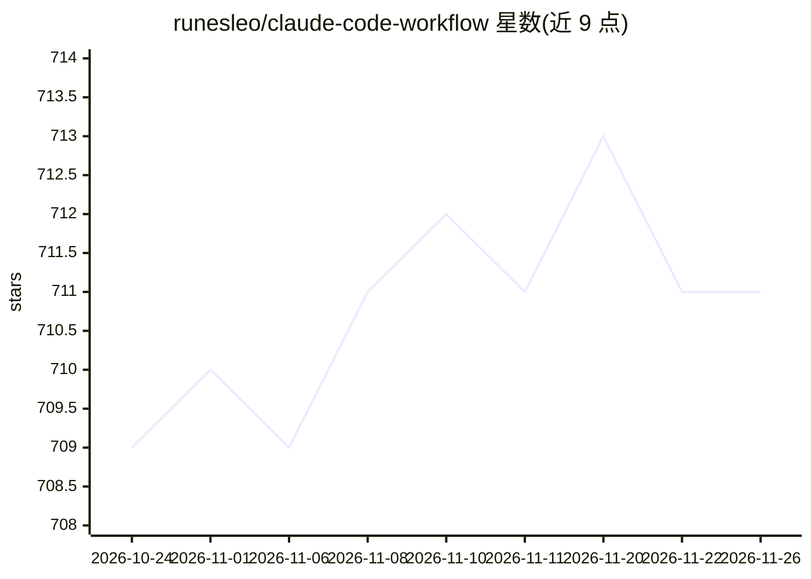

# runesleo/claude-code-workflow

⭐ — · [GitHub]() · 个人维护 · 中文 README

**给 Claude Code/Codex/Cursor 加工作边界的轻量 AI 工作系统**

QuietHarness 是一套面向 AI 一人公司（OPC）工作流的开源系统，当前公开的核心是 QuietHarness Core：以约 1.6KB 的共享配置模板（AGENTS.md/CLAUDE.md/.mdc 规则）为 Claude Code、Codex、Cursor 注入可靠性边界——保留无关改动、按风险验证、不可逆动作先确认、产物落盘。提供 dry-run、时间戳备份与可回滚安装脚本，离线运行、无需 API Key。仓库另含 OPC First Workflow 离线演示（仅 Python 3 标准库）、任务记录结构、单 Writer 写锁与九条业务线组织结构，完整任务数据库与团队编排不在此仓库提供。

## 筛选速览

| 维度 | 判定 | 备注 |
|---|---|---|
| AI 角色 | `ai-ecosystem` | LLM/agent 周边工具 |
| 许可风险 | `permissive` | — |
| 部署形态 | `None` |  |
| 模型依赖 | — | README 未给出锁定关系 |
| 硬件要求 | — | 无带数字的原话,不猜 |
| 安装摩擦 | `low` | 无编译、无系统依赖或容器化 |
| 成熟度 | `idea` | |

## 能力要点

- 1,604 字节共享 Core 模板，三端（Claude Code/Codex/Cursor）共用同一组行为边界
- 安装器默认 dry-run 预览，--apply 前自动创建带时间戳的 .bak 备份，可回滚
- OPC First Workflow 离线演示只需 Git 与 Python 3 标准库，无需 API Key 和网络
- 任务系统以 per-task 文件记录 status/artifact/validation/writeback，支持单 Writer 写锁

## 适用场景

- 为正在用 AI 编程 Agent 维护的真实项目加上防误覆盖、防假完成的工作边界
- 更换 AI 编程工具时复用同一套规则而不必重写配置
- 一人经营研究、内容、产品等业务线时管理多 Agent 任务与事实写回

## 场景标签

`工作流自动化` `编码 Agent` · 领域:效率与自动化

## 证据(README 行号)

> L37: > 给你已经在使用的 AI 编程 Agent 装上一层极小、可回滚的工作边界：先看现状、保留无关改动、按风险验证、对不可逆动作先确认。
> L39: **只用 Claude Code、Codex 或 Cursor 中的一个就能获得同一组核心可靠性边界。** 多端兼容是以后更换工具时可以带走这些边界，不是安装门槛。
> L171: Claude Code、Codex 和 Cursor 都能获得同一组核心可靠性行为，但你只需要安装自己正在使用的客户端。Codex 直接读取 shared `AGENTS.md`，Claude Code 通过薄入口引用它；Cur

## 星数曲线

2026-10-24 709 → 2026-11-26 711（+2）

---
*卡片 v1 · prompt 1.4 · 生成 2026-11-26 · 置信度 high · 依据 README sha `c94fd5d51fc5` · [字段定义](../../DATASET.md)*
