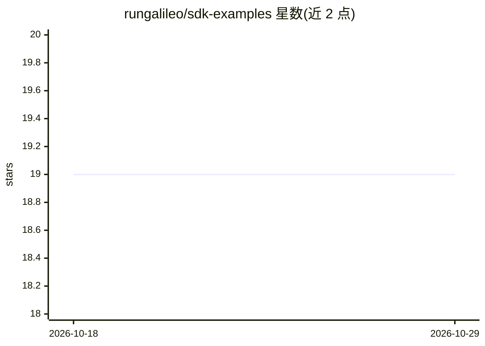

# rungalileo/sdk-examples

⭐ 19 · Python · 推送 2026-07-08 · [GitHub](https://github.com/rungalileo/sdk-examples) · [官网](https://galileo.ai) · 组织维护

**Galileo AI 评测与可观测平台的官方 SDK 示例集**

Galileo.ai 官方维护的示例代码库，演示如何在 Python 与 TypeScript 应用中接入 Galileo SDK 做 LLM 追踪、评测与监控。覆盖 AI Agent（LangChain/LangGraph/CrewAI/多框架）、聊天机器人、RAG 应用、数据集与实验管理等模式，每个目录为独立示例并附各自安装说明。使用需注册 Galileo 账号并获取 API key；入门路径为安装 SDK、克隆本仓库、进入示例目录装依赖后运行。

## 筛选速览

| 维度 | 判定 | 备注 |
|---|---|---|
| AI 角色 | `ai-ecosystem` | LLM/agent 周边工具 |
| 许可风险 | `none` | — |
| 部署形态 | `library` | 以包/库形式分发 |
| 模型依赖 | — | README 未给出锁定关系 |
| 硬件要求 | — | 无带数字的原话,不猜 |
| 安装摩擦 | `low` | 无编译、无系统依赖或容器化 |
| 成熟度 | — | 结构信号不足 |

## 能力要点

- Python 与 TypeScript 双语言的 Agent/Chatbot/RAG/实验示例
- 示例覆盖 LangGraph、CrewAI、OpenTelemetry、Vercel AI 等多种框架集成
- 注册 Galileo 后自动获得 2 个示例项目（聊天机器人、多 Agent 银行机器人）的源码

## 适用场景

- 学习如何在现有 LLM 应用中接入 Galileo 的追踪与评测
- 参考 LangGraph + OpenTelemetry 等可观测性集成模式
- 基于示例快速搭建带评测和监控的 RAG 或 Agent 原型

## 场景标签

`LLM 可观测性` `模型评测` · 领域:评测与运维

## 证据(README 行号)

> L7: This repository contains example implementations and reference code for using the Galileo.ai SDK across both Python 
> L139: - A free account on Galileo.ai

## 星数曲线

2026-10-18 19 → 2026-10-29 19（+0）

---
*卡片 v1 · prompt 1.4 · 生成 2026-10-28 · 置信度 mid · 依据 README sha `5cae16997ff4` · [字段定义](../../DATASET.md)*
