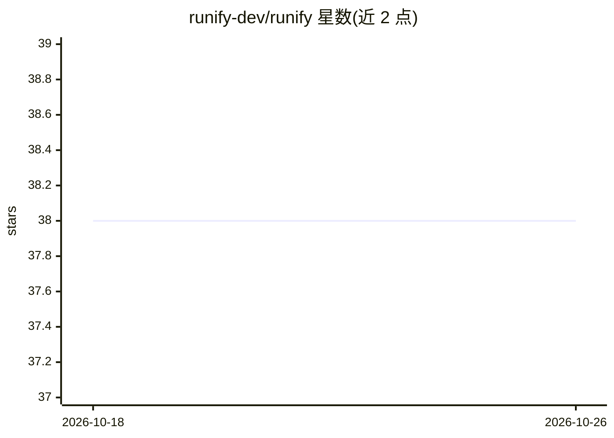

# runify-dev/runify

⭐ 38 · Java · Apache-2.0 · 推送 2026-09-16 · [GitHub](https://github.com/runify-dev/runify) · [官网](https://runify.cn) · 组织维护 · 中文 README

**轻量白盒多智能体平台：可视化编排工作流与知识库**

基于 Electron 的桌面多智能体平台，提供拖拽式 DAG 画布编排 AI 对话、条件分支、循环、数据库查询、代码执行、审批等 11 种节点；内置 Lucene 检索引擎构建私有知识库并支持 RAG 链路；提供 RBAC 权限、统一对话管理与多数据源（PostgreSQL/MySQL/Redis）接入，可通过 API/Webhook 嵌入第三方系统。后端 Java 25 + Vert.x，声称 200MB 内存可运行；提供 macOS/Windows 安装包与跨平台 JAR，无需 Docker。

## 筛选速览

| 维度 | 判定 | 备注 |
|---|---|---|
| AI 角色 | `ai-ecosystem` | LLM/agent 周边工具 |
| 许可风险 | `permissive` | Apache-2.0 |
| 部署形态 | `desktop` | 安装包/桌面程序 |
| 模型依赖 | — | README 未给出锁定关系 |
| 硬件要求 | — | 无带数字的原话,不猜 |
| 安装摩擦 | `medium` | 含编译或系统依赖之一 |
| 成熟度 | — | 结构信号不足 |

## 能力要点

- 拖拽式 DAG 画布编排 11 种节点（AI 对话/循环/审批/HTTP 等）
- 内置 Lucene 高精度检索与 RAG 知识库链路
- RBAC 权限与统一对话管理，支持 PostgreSQL/MySQL/Redis
- macOS/Windows 桌面安装包，声称 200MB 内存可运行

## 适用场景

- 通过可视化画布搭建带工具调用与条件分支的 Agent 流程
- 导入文档构建私有知识库并让 Agent 基于其回答
- 以 API/Webhook 将多智能体能力嵌入现有业务系统

## 场景标签

`多智能体` `工作流自动化` `RAG` · 领域:Agent 开发

## 证据(README 行号)

> L45: 通过拖拽式画布，像搭积木一样自由组合核心节点。基于 DAG（有向无环图）执行引擎，摒弃复杂的 BPMN 规范，更符合开发者直觉。
> L81: Runify 天然为集成而生。通过 API 与 Webhook 即可快速嵌入现有业务系统，无需大规模改造，降低企业 AI 落地门槛。

## 星数曲线

2026-10-18 38 → 2026-10-26 38（+0）

---
*卡片 v1 · prompt 1.4 · 生成 2026-10-25 · 置信度 high · 依据 README sha `3688d361e002` · [字段定义](../../DATASET.md)*
