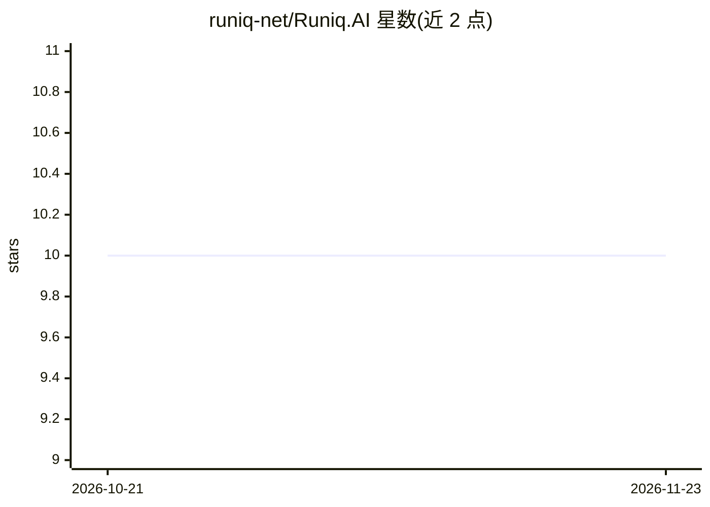

# runiq-net/Runiq.AI

⭐ 10 · C# · MIT · 推送 2026-09-28 · [GitHub](https://github.com/runiq-net/Runiq.AI) · [官网](https://runiq.net/) · 个人维护

**让 .NET 开发者在 ASP.NET Core 应用内构建、运行与观测 AI agent**

Runiq AI 是面向 .NET 的代码优先 agent 运行时：以 C# 定义 agent 与强类型工具，流式输出模型响应，通过托管与依赖注入编排工作流。核心机制包括三种 RAG 执行模式（Open/Grounded/Required）与 grounding 策略、引用校验、可嵌入 ASP.NET Core 进程的 dashboard、MCP 服务暴露能力，以及可选 PostgreSQL+pgvector 持久化。以 NuGet 包分发（Agents/Core/Rag/Memory/Workflows/Mcp/CLI），MIT 许可，需 .NET 10 SDK。

## 筛选速览

| 维度 | 判定 | 备注 |
|---|---|---|
| AI 角色 | `ai-ecosystem` | LLM/agent 周边工具 |
| 许可风险 | `permissive` | MIT |
| 部署形态 | `self-host` | docker 或自建部署 |
| 模型依赖 | — | README 未给出锁定关系 |
| 硬件要求 | — | 无带数字的原话,不猜 |
| 安装摩擦 | `low` | 无编译、无系统依赖或容器化 |
| 成熟度 | — | 结构信号不足 |

## 能力要点

- 以 NuGet 分包按能力组合：Agents、Core、Rag、Memory、Workflows、Mcp、Cli
- RAG 支持 Open/Grounded/Required 三种执行模式与相关性阈值、可选重排序
- 内嵌 dashboard 可浏览 agent、试对话并检查运行时活动
- 可将应用能力以 MCP 服务形式暴露给 MCP 兼容客户端

## 适用场景

- 在 ASP.NET Core 应用里为业务系统添加带工具调用的 agent
- 构建文档助手：摄取、分块、嵌入、检索与引用溯源
- 将现有应用的数据库与文档接入向量检索与问答
- 为 MCP 兼容客户端暴露应用内的工具能力

## 场景标签

`Agent 框架` `RAG` · 领域:Agent 开发

## 证据(README 行号)

> L13: Runiq AI is a code-first agent runtime for .NET. Define agents and strongly typed tools, stream model responses, gr
> L74: |`Runiq.AI.Agents`|Agent definitions, typed tools, providers, streaming, and execution results|Agents|

## 星数曲线

2026-10-21 10 → 2026-11-23 10（+0）

---
*卡片 v1 · prompt 1.4 · 生成 2026-11-19 · 置信度 mid · 依据 README sha `37336a2b55fd` · [字段定义](../../DATASET.md)*
