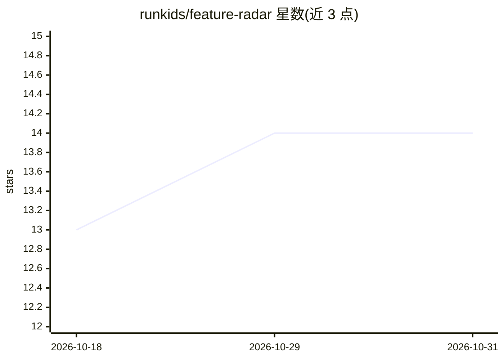

# runkids/feature-radar

⭐ 14 · Shell · MIT · 推送 2026-09-28 · [GitHub](https://github.com/runkids/feature-radar) · 个人维护

**给编程 Agent 的功能规划技能：跨会话积累产品决策记忆**

一套以 SKILL.md 形式分发给编码 Agent 的技能库：在项目内创建 .feature-radar/ 外部知识库，持久保存项目概况(base.md)、机会清单、归档特征与经验教训，让 Agent 跨会话积累上下文。主工作流含 6 阶段(扫描→归档→整理→差距分析→评估→提案)，另有 scan/archive/learn/ref/validate 子技能；用户可通过文件内 NOTE 注释纠正 Agent 判断。数据格式由 SPEC.md 定义，兼容任何支持 SKILL.md 的 Agent(Claude Code、Codex 等)。

## 筛选速览

| 维度 | 判定 | 备注 |
|---|---|---|
| AI 角色 | `ai-ecosystem` | LLM/agent 周边工具 |
| 许可风险 | `permissive` | MIT |
| 部署形态 | `library` | 以包/库形式分发 |
| 模型依赖 | — | README 未给出锁定关系 |
| 硬件要求 | — | 无带数字的原话,不猜 |
| 安装摩擦 | `low` | 无编译、无系统依赖或容器化 |
| 成熟度 | — | 结构信号不足 |

## 能力要点

- 6 阶段主工作流：扫描→归档→整理→差距分析→评估→提案
- .feature-radar/ 目录持久化项目上下文与历史决策，跨会话复用
- 归档强制提取经验教训形成反馈循环
- SPEC.md 定义语言无关数据格式，validate 技能做格式校验与自动修复

## 适用场景

- 让编程 Agent 基于项目历史决策回答'下一步该做什么'
- 跟踪已发布/已否决的功能避免重复建议
- 沉淀架构决策与可复用模式供 Agent 后续引用

## 场景标签

`编码 Agent` `Agent 记忆` · 领域:Agent 开发

## 证据(README 行号)

> L3: **Give your AI agent long-term memory and decision-making ability for feature planning.**
> L164: Any AI agent that supports SKILL.md — Claude Code, Codex, and others.
> L46: skillshare install runkids/feature-radar --into feature-radar

## 星数曲线

2026-10-18 13 → 2026-10-31 14（+1）

---
*卡片 v1 · prompt 1.4 · 生成 2026-10-31 · 置信度 high · 依据 README sha `16dd671a6bc7` · [字段定义](../../DATASET.md)*
