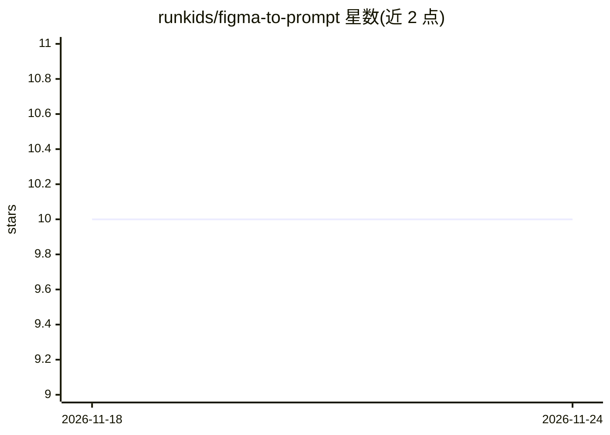

# runkids/figma-to-prompt

⭐ 10 · TypeScript · MIT · 推送 2026-10-24 · [GitHub](https://github.com/runkids/figma-to-prompt) · 个人维护

**Figma 插件：把设计稿导出为结构化 JSON 与 AI 提示词**

运行在 Figma 内的插件，将选中的 frame/component/group 捕获为完整节点层级的 JSON 与框架无关的 Markdown 提示词，并打包 .figmacapture.zip（含节点 JSON、参考渲染图、PNG/SVG 回退资源）。内置视觉校验器将 AI 生成的截图与 Figma 渲染逐像素比对，低于 100% 时生成含品红 diff 与优先级错误区域的修正包；采用 fail-close 机制，缺失资源即阻止下载。可通过 skillshare 安装技能教 coding agent 读取输出。维护者构建需 Node.js >= 18 与 pnpm。

## 筛选速览

| 维度 | 判定 | 备注 |
|---|---|---|
| AI 角色 | `ai-ecosystem` | LLM/agent 周边工具 |
| 许可风险 | `permissive` | MIT |
| 部署形态 | `desktop` | 安装包/桌面程序 |
| 模型依赖 | — | README 未给出锁定关系 |
| 硬件要求 | — | 无带数字的原话,不猜 |
| 安装摩擦 | `low` | 无编译、无系统依赖或容器化 |
| 成熟度 | — | 结构信号不足 |

## 能力要点

- 选中节点导出为结构化 JSON 与含设计 tokens 的 AI-ready Markdown 提示词
- 内置视觉校验器：AI 截图与 Figma 渲染逐像素比对并生成 diff 修正包
- fail-close 机制：缺失引用/资源时阻止下载并指明节点
- 附带 skillshare 格式的 design-to-code 技能供 coding agent 安装

## 适用场景

- 把 Figma 设计稿交给 ChatGPT/Claude 等 LLM 生成前端组件
- 对 AI 生成的前端页面做逐像素还原度校验并迭代修正
- 向 coding agent（Claude Code/Cursor 等）传递带资产与布局规范的设计上下文

## 场景标签

`提示工程` `代码生成` · 领域:Agent 开发

## 证据(README 行号)

> L3: A Figma plugin that captures a selection as structured JSON and an AI-ready Markdown prompt. Feed the output to Chat
> L73: ## Using it with an AI coding agent
> L5: > **Using a coding agent (Claude Code, Cursor, Codex, Pi)?** Try **figlens**. It reads a saved `.fig` (File > Save l

## 星数曲线

2026-11-18 10 → 2026-11-24 10（+0）

---
*卡片 v1 · prompt 1.4 · 生成 2026-11-19 · 置信度 mid · 依据 README sha `223c56ca6bd9` · [字段定义](../../DATASET.md)*
