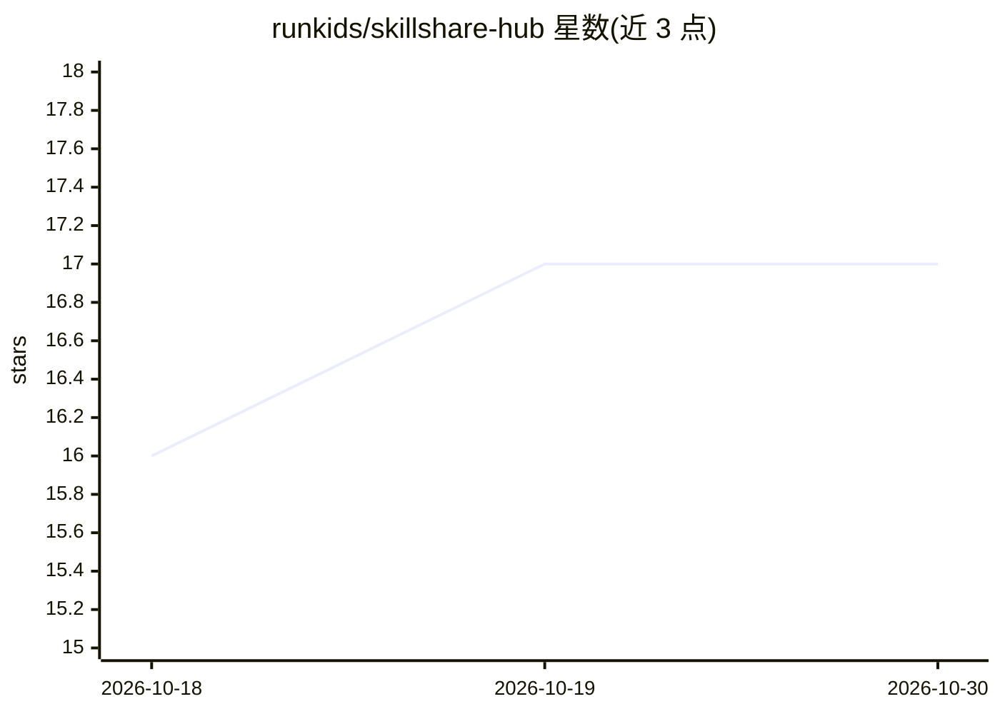

# runkids/skillshare-hub

⭐ 17 · Shell · MIT · 推送 2026-10-26 · [GitHub](https://github.com/runkids/skillshare-hub) · 个人维护 · 中文 README

**AI CLI 技能策展目录：232 个技能、11 类，可自建组织内部 hub**

skillshare 的官方默认技能目录仓库，收录 232 个 agent 技能，按前端、营销、工作流等 11 个类别组织，每个条目标注风险等级（clean/low/medium/high/critical）与用途描述。用户通过 skillshare CLI（search --hub）或其 Web UI 的 Hubs 页面搜索、预览、审计并安装技能；也可 fork 本仓库替换为组织内部技能目录，沿用相同 schema 与 CI 流水线。仓库本身是数据目录，不含可运行代码。

## 筛选速览

| 维度 | 判定 | 备注 |
|---|---|---|
| AI 角色 | `ai-knowledge` | 知识聚合/清单类 |
| 许可风险 | `permissive` | MIT |
| 部署形态 | `None` |  |
| 模型依赖 | — | README 未给出锁定关系 |
| 硬件要求 | — | 无带数字的原话,不猜 |
| 安装摩擦 | `low` | 无编译、无系统依赖或容器化 |
| 成熟度 | — | 结构信号不足 |

## 能力要点

- 232 个技能按 11 个类别组织，逐条标注风险等级
- 预装为 skillshare 默认 hub，CLI 与 Web UI 均可检索
- 每个技能安装前经过审计，可预览内容、许可证与标签
- 支持 fork 自建组织内部 hub，沿用相同 schema 与工具链

## 适用场景

- 为 skillshare CLI 查找并安装现成的 agent 技能
- 按风险等级筛选要引入团队的技能
- fork 仓库搭建组织内部的技能分发 hub

## 场景标签

`精选清单` · 领域:学习与行业

## 证据(README 行号)

> L3:  A curated catalog of skillshare skills — and a reference for building your own.
> L13: 1. **Ready-to-use catalog** — Pre-configured as the default hub in skillshare. Run `skillshare search --hub` or ope
> L14: 2. **Reference for your own hub** — Fork this repo, replace the skills with your organization's catalog, and custom

## 星数曲线

2026-10-18 16 → 2026-10-30 17（+1）

---
*卡片 v1 · prompt 1.4 · 生成 2026-10-29 · 置信度 high · 依据 README sha `b8885e6f9294` · [字段定义](../../DATASET.md)*
