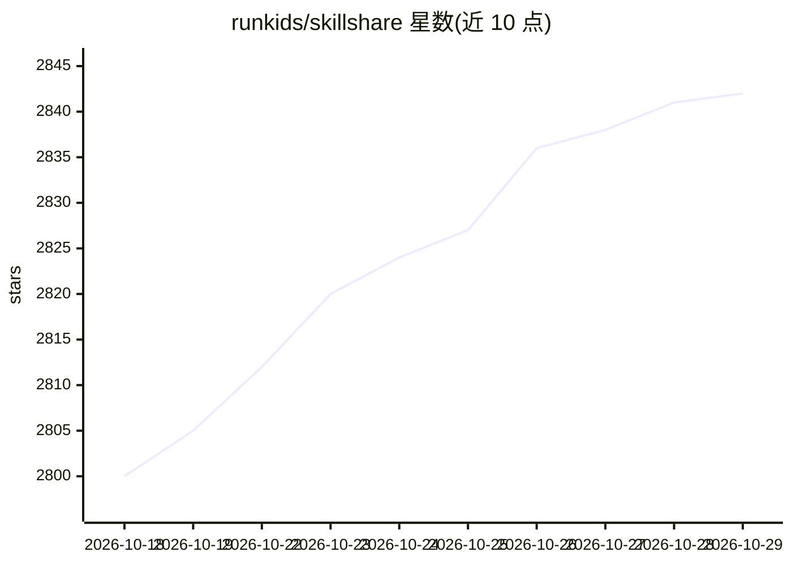

# runkids/skillshare

⭐ 2,842 · Go · MIT · 推送 2026-10-28 · [GitHub](https://github.com/runkids/skillshare) · [官网](https://skillshare.runkids.cc) · 个人维护 · 中文 README

**跨 AI CLI 工具同步 skills/agents/MCP/hooks 的统一管理工具**

用 Go 编写的 CLI 与桌面应用，将 skills、agents、rules、MCP 连接、hooks 与 plugins 集中在单一源目录管理，通过 symlink（或 copy 模式）同步到 Claude Code、Codex、Pi、OpenCode、VS Code 等目标工具。支持从任意 Git 主机安装/更新 skills、内置安全审计、项目级 .skillshare 配置、本地 commit 检查点与 Web 仪表盘。面向需要跨工具、跨机器保持 AI 编码配置一致并做团队共享的开发者；单二进制，无 Node.js 运行时依赖。

## 筛选速览

| 维度 | 判定 | 备注 |
|---|---|---|
| AI 角色 | `ai-ecosystem` | LLM/agent 周边工具 |
| 许可风险 | `permissive` | MIT |
| 部署形态 | `None` |  |
| 模型依赖 | — | README 未给出锁定关系 |
| 硬件要求 | — | 无带数字的原话,不猜 |
| 安装摩擦 | `low` | 无编译、无系统依赖或容器化 |
| 成熟度 | — | 结构信号不足 |

## 能力要点

- 单一源目录经 symlink/copy 同步到多个 AI CLI 工具
- skillshare audit 安全扫描，install/update 时自动执行
- MCP 连接与 hooks 声明式管理，dry-run 预览变更
- 桌面应用（macOS/Windows/Linux）与 Web 仪表盘两种界面

## 适用场景

- 团队把共享 skills 随仓库分发，新成员一条命令完成配置
- 同时在多个 AI 编码工具间保持 skills/agents/MCP 配置一致
- 换机器时用 git clone 配置后 skillshare sync 恢复环境
- 在 skills 进入 agent 前做安全审计

## 场景标签

 · 领域:开发者工具/AI 基础设施

## 证据(README 行号)

> L21:  Manage skills, agents, rules, MCP connections and hooks in one place.
> L22:  For Claude Code, Codex, Pi, OpenCode and more.
> L42: - **Switch tools, keep your skills** — edit once, then sync to Claude Code, Codex, Pi and the other tools you use.

## 星数曲线

2026-10-18 2,800 → 2026-10-29 2,842（+42）

---
*卡片 v1 · prompt 1.4 · 生成 2026-10-21 · 置信度 high · 依据 README sha `873e7b76f67a` · [字段定义](../../DATASET.md)*
