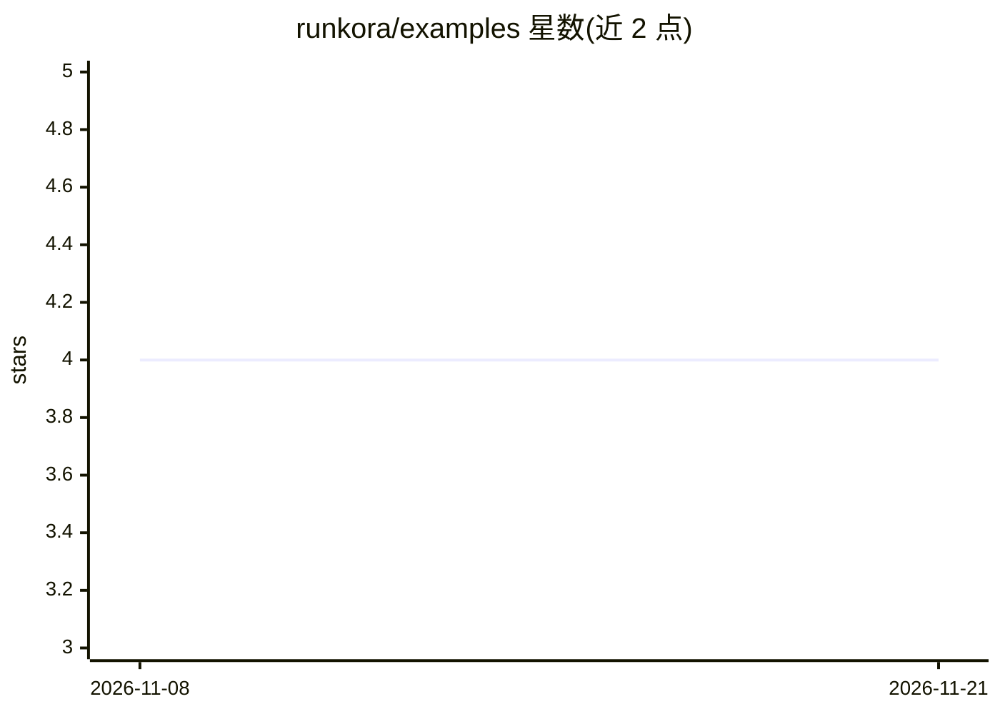

# runkora/examples

⭐ 4 · Makefile · Apache-2.0 · 推送 2026-10-30 · [GitHub](https://github.com/runkora/examples) · 组织维护

**runkora/kora 生产级 agent 工厂的示例清单仓库**

该仓库为 runkora（在生产环境运行 agent 工厂的开源控制平面）提供可运行的示例。每个示例是一组 Kubernetes manifests，声明租户、模型、agent、触发器与角色，并提供单/多租户、自动修复、SRE 告警分诊、功能需求拆解等工厂样例。`make up` 在本地 k3d 集群安装 kora；`versions.mk` 固定 kora、Istio、SPIRE、External Secrets Operator 与 k3s 版本；`make validate` 按 schema 校验 manifests。manifests 按所有者分目录，生产中可由 Argo CD 或 Flux 以 GitOps 方式部署。

## 筛选速览

| 维度 | 判定 | 备注 |
|---|---|---|
| AI 角色 | `ai-ecosystem` | LLM/agent 周边工具 |
| 许可风险 | `permissive` | Apache-2.0 |
| 部署形态 | `None` |  |
| 模型依赖 | — | README 未给出锁定关系 |
| 硬件要求 | — | 无带数字的原话,不猜 |
| 安装摩擦 | `low` | 无编译、无系统依赖或容器化 |
| 成熟度 | — | 结构信号不足 |

## 能力要点

- `make up` 在本地 k3d 集群一键安装 kora
- 示例以 Kubernetes manifests 声明租户、模型、agent、触发器与角色
- versions.mk 固定 kora/Istio/SPIRE/ESO/k3s 版本，make validate 做多 schema 校验
- 示例 manifests 按平台团队与租户分目录，适配 GitOps 仓库拆分

## 适用场景

- 在本地集群体验 agent 工厂控制平面的部署流程
- 参考 single/multi-tenant 示例组织团队自有租户配置
- 复用 autofix/sre/feature 工厂样例搭建自己的 agent 工厂

## 场景标签

`Agent 框架` `多智能体` `编码 Agent` · 领域:Agent 开发

## 证据(README 行号)

> L3: This repository holds runnable examples for runkora, an open source control plane for running agent factories in pro
> L19: An example is a set of Kubernetes manifests that declare tenants, models, agents, triggers and roles for kora. Choo

## 星数曲线

2026-11-08 4 → 2026-11-21 4（+0）

---
*卡片 v1 · prompt 1.4 · 生成 2026-11-21 · 置信度 high · 依据 README sha `05d2d35439b5` · [字段定义](../../DATASET.md)*
