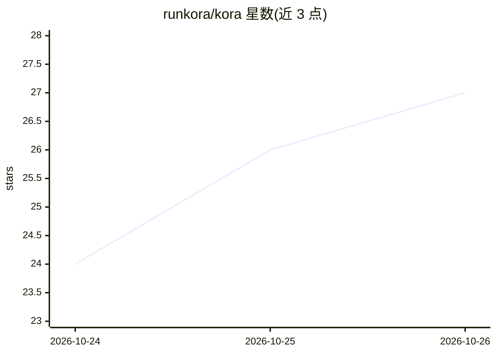

# runkora/kora

⭐ 27 · Go · Apache-2.0 · 推送 2026-10-25 · [GitHub](https://github.com/runkora/kora) · [官网](https://runkora.io) · 组织维护

**生产环境运行 agent 工厂的开源控制平面**

面向在 Kubernetes 上规模化运行 AI agent 的工程团队的控制平面软件。它运行既有的 agent harness（如 Claude Code、Codex、OpenCode），提供持久化沙箱运行、独立 agent 身份与委托权限、策略评估、外呼拦截与即时凭据注入等治理能力，并通过控制台展示 agent 数量、运行状态、token 用量与支出。以 Kubernetes 部署或本地开发两种方式提供，Apache 2.0 许可。

## 筛选速览

| 维度 | 判定 | 备注 |
|---|---|---|
| AI 角色 | `ai-ecosystem` | LLM/agent 周边工具 |
| 许可风险 | `permissive` | Apache-2.0 |
| 部署形态 | `None` |  |
| 模型依赖 | — | README 未给出锁定关系 |
| 硬件要求 | — | 无带数字的原话,不猜 |
| 安装摩擦 | `low` | 无编译、无系统依赖或容器化 |
| 成熟度 | — | 结构信号不足 |

## 能力要点

- 在 Kubernetes 上运行既有 agent harness（Claude Code/Codex/OpenCode）
- 每个 agent 独立身份与委托权限，策略先行评估每个动作
- 拦截外呼并注入即时作用域凭据，agent 不直接持有凭据
- webhook/队列/定时/API/人工触发的持久化沙箱运行

## 适用场景

- 把开发本地的 agent 安全地迁移到生产环境规模化运行
- 对 agent 的操作做身份、权限与策略治理并留存审计
- 追踪各 agent 的 token 用量与支出

## 场景标签

`Agent 框架` · 领域:Agent 开发

## 证据(README 行号)

> L5: kora is an open source control plane for running agent factories in production. An agent on a laptop runs with its d
> L7: kora is not an agent framework, a model router, or an LLM wrapper. It runs the agent harnesses you already use, such

## 星数曲线

2026-10-24 24 → 2026-10-26 27（+3）

---
*卡片 v1 · prompt 1.4 · 生成 2026-10-26 · 置信度 high · 依据 README sha `30c96868f1ec` · [字段定义](../../DATASET.md)*
