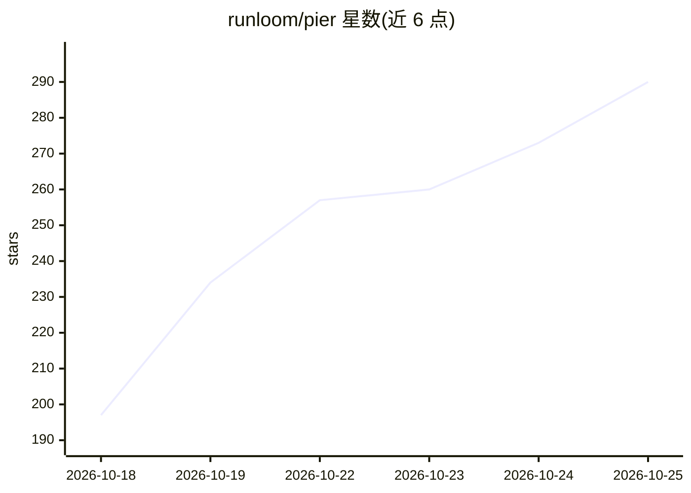

# runloom/pier

⭐ 320 · TypeScript · AGPL-3.0 · 推送 2026-10-23 · [GitHub](https://github.com/runloom/pier) · [官网](https://pier.codes) · 组织维护 · 中文 README

**macOS 本地工作台：集中查看多个 AI 终端会话状态，旁边改文件、看 Git**

Electron 构建的 macOS 桌面应用（Apple Silicon / Intel），作为原生终端工作台运行 Claude Code、Codex、OpenCode 等命令行编程智能体：集中展示运行中、需处理、出错的会话并一键回到对应终端；内置文件编辑、diff 审查、按文件或片段暂存提交推送；为每个任务开独立 Git 工作树目录；提供本机 pier CLI 与签名校验的插件机制。产品边界明确：不带任务台账与自动调度，Canvas 看板仍在开发中。AGPL-3.0 发布，闭源分发需商业协议。

## 筛选速览

| 维度 | 判定 | 备注 |
|---|---|---|
| AI 角色 | `ai-enhanced` | 去掉 AI 部分产品仍成立 |
| 许可风险 | `viral` | AGPL-3.0 |
| 部署形态 | `None` |  |
| 模型依赖 | — | README 未给出锁定关系 |
| 硬件要求 | — | 无带数字的原话,不猜 |
| 安装摩擦 | `low` | 无编译、无系统依赖或容器化 |
| 成熟度 | `idea` | |

## 能力要点

- 运行中/需处理/出错的智能体会话集中可见，点击回到原终端
- 每个任务独立 Git 工作树目录，文件编辑与片段级暂存提交内置
- 界面重载后正在运行的终端可继续使用
- 本机 pier CLI 可打开项目、定位面板、发送文本或按键

## 适用场景

- 同时开多个 Claude Code / Codex 会话时追踪谁在等我处理
- 在智能体旁边直接改代码、审 diff、提交推送，不切编辑器
- 用独立工作树为不同任务隔离文件改动

## 场景标签

 · 领域:开发者工具/终端工作台

## 证据(README 行号)

> L25: **还是原来的终端。** 不是又一个聊天窗口。账号和订阅不动。Claude Code、Codex、OpenCode 还在它们自己的终端里跑。
> L40: - **原生终端** — 在项目或工作树中运行 Shell 和命令行编程智能体；界面重新加载后，正在运行的终端仍可继续使用
> L41: - **会话状态** — 一处查看运行中、需要你处理和出错的会话，点击即可回到对应终端

## 星数曲线

2026-10-18 197 → 2026-10-25 290（+93）

---
*卡片 v1 · prompt 1.4 · 生成 2026-10-22 · 置信度 high · 依据 README sha `87146121aac8` · [字段定义](../../DATASET.md)*
