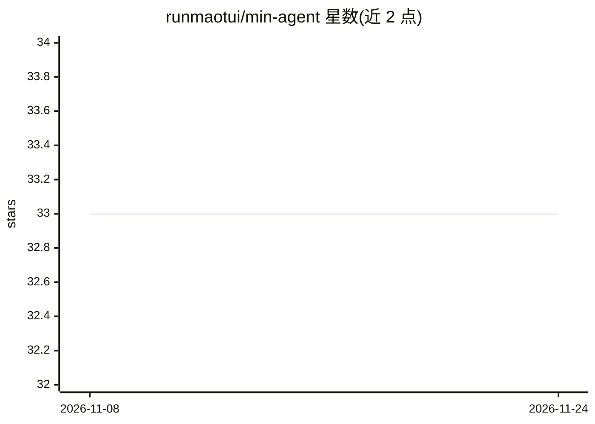

# runmaotui/min-agent

⭐ 33 · Python · MIT · 推送 2026-07-20 · [GitHub](https://github.com/runmaotui/min-agent) · 个人维护 · 中文 README

**可本地运行的 Agent 循环演示器，带权限门控与 Trace 回放**

一个面向教学与机制演示的最小 Web Agent：以克隆仓库直接运行（不提供 PyPI 安装），支持 Python 3.10+ 的 macOS/Linux。核心是真实运行的 Agentic Loop——模型返回受控 AgentAction，本地运行时负责路径校验、命令白名单、权限确认与执行；write_file/run_command 需使用者网页批准。提供确定性的 Fake 模式（不访问外部服务）与 DeepSeek 模式（Key 仅存内存），Trace 支撑实时观察、错误定位与只读历史回放，另含单次 CLI 入口。明确声明非生产级、维护冻结期，且不含远程/多用户/MCP 等能力。

## 筛选速览

| 维度 | 判定 | 备注 |
|---|---|---|
| AI 角色 | `ai-ecosystem` | LLM/agent 周边工具 |
| 许可风险 | `permissive` | MIT |
| 部署形态 | `library` | 以包/库形式分发 |
| 模型依赖 | locked-api |  |
| 硬件要求 | — | 无带数字的原话,不猜 |
| 安装摩擦 | `low` | 无编译、无系统依赖或容器化 |
| 成熟度 | — | 结构信号不足 |

## 能力要点

- 模型只能返回受支持的 AgentAction，执行与权限确认由本地运行时负责
- Fake 确定性模式无需外部服务，DeepSeek 模式 Key 仅存内存不落盘
- write_file/run_command 需网页权限批准，命令仅限本地注册白名单
- 结构化 Trace 支撑实时观察、错误定位与只读历史回放

## 适用场景

- 在网页上观察 Agent 循环如何判断、调用工具并吸收结果
- 教学或测试中演示带权限门控的工具调用机制
- 回放历史运行记录定位 Agent 执行错误

## 场景标签

`Agent 框架` · 领域:Agent 开发

## 证据(README 行号)

> L3: 一个可观察、可本地运行的最小 Agent 机制演示器。
> L5: 它不是生产级 Agent，也不是迷你版 Claude Code。这个项目只做一件事：让你从页面上看清楚 Agent 如何围绕目标持续判断、调用受控工具、吸收执行结果，最后完成任务。
> L50: 模型不能直接读写文件或执行命令。它只能返回受支持的 `AgentAction`；路径校验、命令白名单、权限确认和实际执行都由本地运行时负责。

## 星数曲线

2026-11-08 33 → 2026-11-24 33（+0）

---
*卡片 v1 · prompt 1.4 · 生成 2026-11-18 · 置信度 mid · 依据 README sha `7cee65167e80` · [字段定义](../../DATASET.md)*
