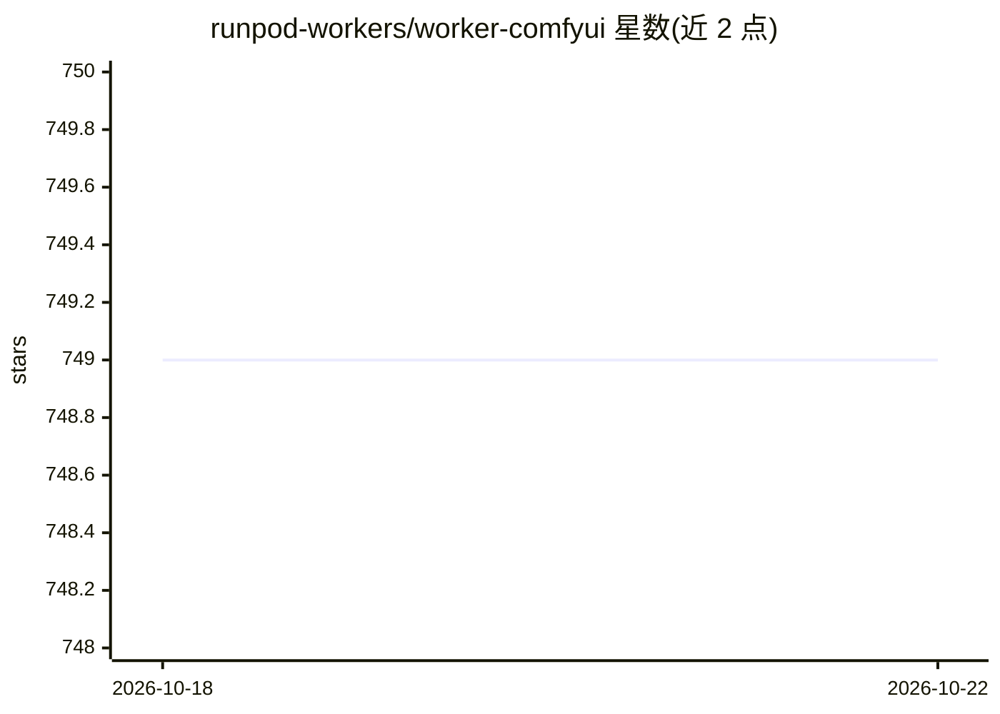

# runpod-workers/worker-comfyui

⭐ 749 · Python · AGPL-3.0 · 推送 2026-09-21 · [GitHub](https://github.com/runpod-workers/worker-comfyui) · 组织维护

**把 ComfyUI 工作流封装为 RunPod Serverless API 的 worker**

面向 RunPod 平台的 serverless worker 项目：将 ComfyUI 部署为 API 端点，用户通过 /run、/runsync 提交 ComfyUI 导出的 workflow JSON，可附带输入图片，收到 base64 或 S3 URL 形式的生成图片。提供 base/FLUX.1 schnell/FLUX.1 dev/SDXL/SD3 多种预置 Docker 镜像，支持 S3 上传、webhook 通知、SSH 访问等配置。给需要在生产环境以 API 形式运行 ComfyUI 工作流的开发者使用。注意 5.0.0 起输出格式有不兼容变更。

## 筛选速览

| 维度 | 判定 | 备注 |
|---|---|---|
| AI 角色 | `ai-ecosystem` | LLM/agent 周边工具 |
| 许可风险 | `viral` | AGPL-3.0 |
| 部署形态 | `desktop` | 安装包/桌面程序 |
| 模型依赖 | — | README 未给出锁定关系 |
| 硬件要求 | — | 无带数字的原话,不猜 |
| 安装摩擦 | `low` | 无编译、无系统依赖或容器化 |
| 成熟度 | — | 结构信号不足 |

## 能力要点

- 提交 ComfyUI workflow JSON 经 /runsync 或 /run 端点生成图片
- 多种预置 Docker 镜像（base/FLUX.1 schnell/dev/SDXL/SD3）
- 输出支持 base64 字符串或 S3 URL 两种模式
- 支持输入图片上传、webhook 通知与 SSH 访问配置

## 适用场景

- 把已有的 ComfyUI 工作流部署为 serverless 图片生成 API
- 在 RunPod 上按需扩缩地运行 SD/FLUX 出图服务
- 将生成结果直接上传 S3 供下游系统消费

## 场景标签

`图像生成` `推理引擎` · 领域:内容生成

## 证据(README 行号)

> L7: This project allows you to run ComfyUI workflows as a serverless API endpoint on the RunPod platform. Submit workflo
> L33: The worker exposes standard RunPod serverless endpoints (`/run`, `/runsync`, `/health`). By default, images are ret

## 星数曲线

2026-10-18 749 → 2026-10-22 749（+0）

---
*卡片 v1 · prompt 1.4 · 生成 2026-10-21 · 置信度 high · 依据 README sha `26646a87057a` · [字段定义](../../DATASET.md)*
