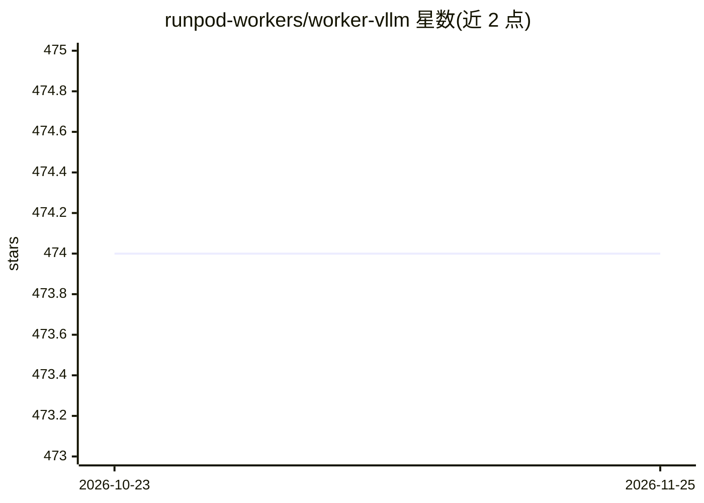

# runpod-workers/worker-vllm

⭐ 474 · Python · MIT · 推送 2026-11-19 · [GitHub](https://github.com/runpod-workers/worker-vllm) · 组织维护

**RunPod Serverless 上托管 vLLM 大模型端点的 worker 模板**

RunPod 官方的 serverless worker 模板，将 vLLM 推理引擎封装为可在 RunPod Serverless 端点上部署的 OpenAI 兼容服务。配置通过环境变量或 config.yaml 传入，环境变量会转换为 `vllm serve` CLI 参数，并提供 VLLM_EXTRA_ARGS 透传未收录参数。支持预构建 Docker 镜像部署、将模型烘焙进镜像构建，以及直接使用官方 vllm 镜像做负载均衡三种方式。启动失败时识别可修复的崩溃循环并以结构化错误应答任务。限制：仅在 RunPod Serverless 平台运行。

## 筛选速览

| 维度 | 判定 | 备注 |
|---|---|---|
| AI 角色 | `ai-ecosystem` | LLM/agent 周边工具 |
| 许可风险 | `permissive` | MIT |
| 部署形态 | `self-host` | docker 或自建部署 |
| 模型依赖 | local-ok | 支持本地模型 |
| 硬件要求 | — | 无带数字的原话,不猜 |
| 安装摩擦 | `low` | 无编译、无系统依赖或容器化 |
| 成熟度 | — | 结构信号不足 |

## 能力要点

- 环境变量到 vllm serve CLI 参数的自动转换与 VLLM_EXTRA_ARGS 透传
- OpenAI 兼容 API，改 3 行即可接入现有 OpenAI 代码库
- 支持 config.yaml 完整配置与 env 变量优先级控制
- 预启动钩子识别不可修复的启动失败并给出原因与修复建议

## 适用场景

- 在 RunPod Serverless 上按需部署 Hugging Face 上的 vLLM 支持模型
- 将现有 OpenAI SDK 代码切换到自托管模型端点
- 将模型打包进 Docker 镜像进行离线部署

## 场景标签

`推理引擎` · 领域:训练与推理

## 证据(README 行号)

> L3: Deploy OpenAI-Compatible Blazing-Fast LLM Endpoints powered by the vLLM Inference Engine on Runpod Serverless with j
> L43: **Pass any vLLM engine arg** as an environment variable: the worker translates env vars into `vllm serve` CLI flags
> L187: The vLLM Worker is fully compatible with OpenAI's API, and you can use it with any OpenAI Codebase by changing onl

## 星数曲线

2026-10-23 474 → 2026-11-25 474（+0）

---
*卡片 v1 · prompt 1.4 · 生成 2026-11-25 · 置信度 high · 依据 README sha `67597e6c4f32` · [字段定义](../../DATASET.md)*
