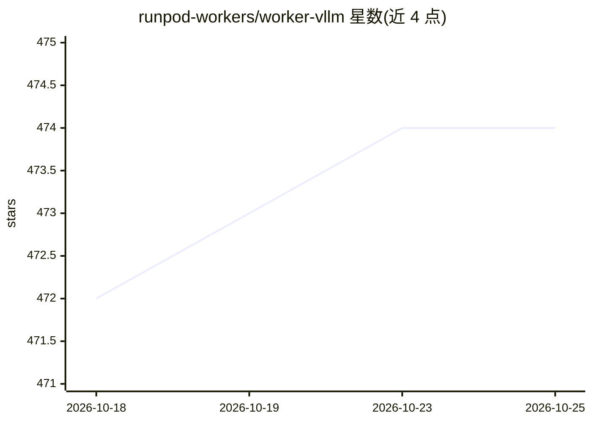

# runpod-workers/worker-vllm

⭐ 474 · Python · MIT · 推送 2026-10-22 · [GitHub](https://github.com/runpod-workers/worker-vllm) · 组织维护

**在 Runpod Serverless 上部署 vLLM 推理端点的 worker 模板**

Runpod 官方 worker 模板，将 vLLM 推理引擎封装为 OpenAI 兼容的 Serverless 端点：通过环境变量或 config.yaml 传入任意 vllm serve 参数，支持模型量化、张量并行、并发限制、工具调用解析等配置。提供三种使用方式：预构建 Docker 镜像直接部署、构建内嵌模型的自定义镜像、或直接部署官方 vllm-openai 镜像做负载均衡。可部署 Hugging Face 上所有 vLLM 支持的模型，兼容 OpenAI SDK（改 base_url 与 api_key 即可迁移）。

## 筛选速览

| 维度 | 判定 | 备注 |
|---|---|---|
| AI 角色 | `ai-ecosystem` | LLM/agent 周边工具 |
| 许可风险 | `permissive` | MIT |
| 部署形态 | `self-host` | docker 或自建部署 |
| 模型依赖 | local-ok | 支持本地模型 |
| 硬件要求 | — | 无带数字的原话,不猜 |
| 安装摩擦 | `low` | 无编译、无系统依赖或容器化 |
| 成熟度 | — | 结构信号不足 |

## 能力要点

- 环境变量自动映射为 vllm serve CLI 参数，另有 VLLM_EXTRA_ARGS 透传机制
- OpenAI API 兼容，覆盖 Chat Completions/Models/Responses/Messages 路由
- 启动失败可识别原因并通过 job 返回错误与修复建议，避免 crash-loop
- 支持 QUANTIZATION、TENSOR_PARALLEL_SIZE 等模型配置项

## 适用场景

- 在 Runpod Serverless 上低成本部署开源 LLM 推理端点
- 把现有 OpenAI SDK 代码迁移到自部署模型
- 通过 Docker 构建内嵌模型权重的镜像简化部署

## 场景标签

`推理引擎` · 领域:训练与推理

## 证据(README 行号)

> L1: # OpenAI-Compatible vLLM Serverless Endpoint Worker
> L3: Deploy OpenAI-Compatible Blazing-Fast LLM Endpoints powered by the vLLM Inference Engine on Runpod Serverless with j
> L184: The vLLM Worker is fully compatible with OpenAI's API, and you can use it with any OpenAI Codebase by changing onl

## 星数曲线

2026-10-18 472 → 2026-10-25 474（+2）

---
*卡片 v1 · prompt 1.4 · 生成 2026-10-22 · 置信度 high · 依据 README sha `cf15c6716c0b` · [字段定义](../../DATASET.md)*
