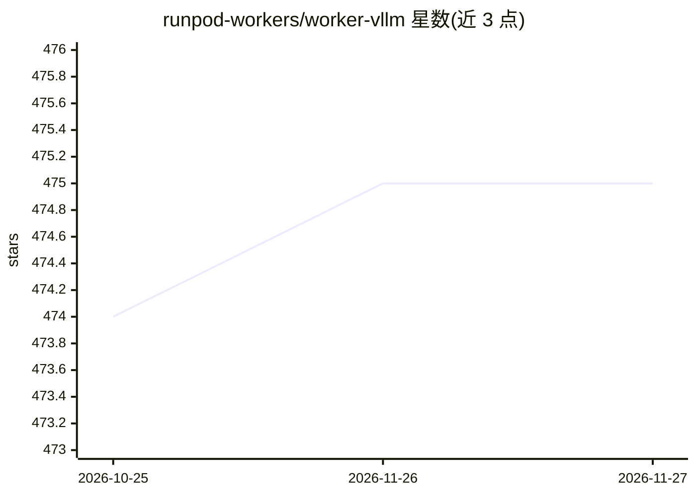

# runpod-workers/worker-vllm

⭐ 475 · Python · MIT · 推送 2026-11-26 · [GitHub](https://github.com/runpod-workers/worker-vllm) · 组织维护

**RunPod Serverless 上基于 vLLM 的 LLM 端点部署模板**

在 RunPod Serverless 上部署 vLLM 推理端点的 worker 模板，封装官方 vllm/vllm-openai 镜像。配置通过环境变量或 config.yaml 传递，环境变量自动映射为 vllm serve CLI 参数，并提供 VLLM_EXTRA_ARGS 透传任意参数。提供三种部署方式：预构建 Docker 镜像、模型打包进镜像构建、以及负载均衡场景下直接使用官方 vLLM 镜像（无需本 worker）。兼容 OpenAI API 格式，现有 OpenAI 代码只需改 base_url 和 api_key 即可接入。启动失败场景会被识别并向任务返回原因与修复建议。

## 筛选速览

| 维度 | 判定 | 备注 |
|---|---|---|
| AI 角色 | `ai-ecosystem` | LLM/agent 周边工具 |
| 许可风险 | `permissive` | MIT |
| 部署形态 | `self-host` | docker 或自建部署 |
| 模型依赖 | local-ok | 支持本地模型 |
| 硬件要求 | — | 无带数字的原话,不猜 |
| 安装摩擦 | `low` | 无编译、无系统依赖或容器化 |
| 成熟度 | — | 结构信号不足 |

## 能力要点

- 环境变量自动转换为 vllm serve CLI 参数，支持 VLLM_EXTRA_ARGS 透传
- OpenAI 兼容 API，改 3 行代码即可从 OpenAI SDK 切换
- 启动失败识别机制：向队列任务返回错误原因与修复建议
- 支持 config.yaml 完整配置文件挂载

## 适用场景

- 在 RunPod Serverless 上按需部署 Hugging Face 模型端点
- 用现有 OpenAI 代码库接入自部署的 vLLM 模型
- 将模型权重打包进镜像做免下载部署

## 场景标签

`推理引擎` · 领域:训练与推理

## 证据(README 行号)

> L3: Deploy OpenAI-Compatible Blazing-Fast LLM Endpoints powered by the vLLM Inference Engine on Runpod Serverless with j
> L9: > Want a **load balancing** endpoint (direct HTTP, no job queue)? You don't need this worker — deploy the official v
> L187: The vLLM Worker is fully compatible with OpenAI's API, and you can use it with any OpenAI Codebase by changing onl

## 星数曲线

2026-10-25 474 → 2026-11-27 475（+1）

---
*卡片 v1 · prompt 1.4 · 生成 2026-11-26 · 置信度 high · 依据 README sha `50d2f79bdba1` · [字段定义](../../DATASET.md)*
