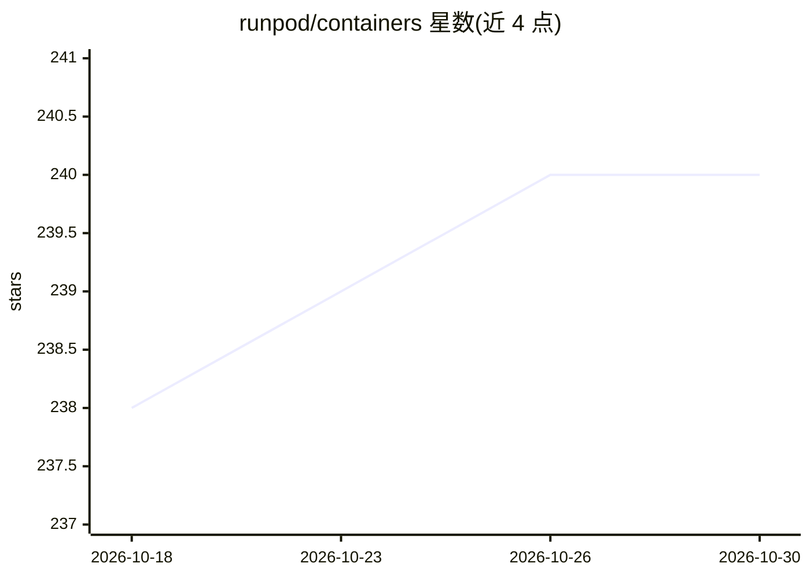

# runpod/containers

⭐ 240 · Python · MIT · 推送 2026-10-29 · [GitHub](https://github.com/runpod/containers) · [官网](https://hub.docker.com/u/runpod) · 组织维护

**Runpod 官方模板容器镜像的 Dockerfile 集合**

由 Runpod 维护的仓库，收录其官方模板所用容器镜像的 Dockerfile，构建产物发布于 Docker Hub。镜像需包含 nginx、openssh-server、jupyterlab 三项依赖以支持平台代理端口、SSH 与 JupyterLab 访问（sandbox 类镜像除外）。构建基于 Docker Buildx 与 bake 文件，bake.sh 脚本合并共享版本定义与各模板专属配置；CUDA、Ubuntu、PyTorch 的版本兼容性集中于 versions.hcl 管理。面向在 Runpod 平台使用或自定义官方模板的用户。

## 筛选速览

| 维度 | 判定 | 备注 |
|---|---|---|
| AI 角色 | `ai-ecosystem` | LLM/agent 周边工具 |
| 许可风险 | `permissive` | MIT |
| 部署形态 | `self-host` | docker 或自建部署 |
| 模型依赖 | — | README 未给出锁定关系 |
| 硬件要求 | — | 无带数字的原话,不猜 |
| 安装摩擦 | `low` | 无编译、无系统依赖或容器化 |
| 成熟度 | — | 结构信号不足 |

## 能力要点

- 提供 Runpod 官方模板的 Dockerfile，镜像发布于 Docker Hub
- 统一依赖要求：nginx/openssh-server/jupyterlab（sandbox 镜像除外）
- bake.sh 脚本集中管理 CUDA/Ubuntu/PyTorch 版本兼容性

## 适用场景

- 查看 Runpod 官方模板镜像的构建方式
- 基于官方 Dockerfile 定制自己的容器镜像
- 了解 Runpod 平台容器的依赖要求

## 场景标签

 · 领域:云计算/容器基础设施

## 证据(README 行号)

> L3: This repository contains the Dockerfiles for the Runpod containers used for our official templates. Built containers
> L42: Version compatibility and build targets for CUDA, Ubuntu, and PyTorch are centralized in `official-templates/shared

## 星数曲线

2026-10-18 238 → 2026-10-30 240（+2）

---
*卡片 v1 · prompt 1.4 · 生成 2026-10-22 · 置信度 high · 依据 README sha `638b932e95c8` · [字段定义](../../DATASET.md)*
