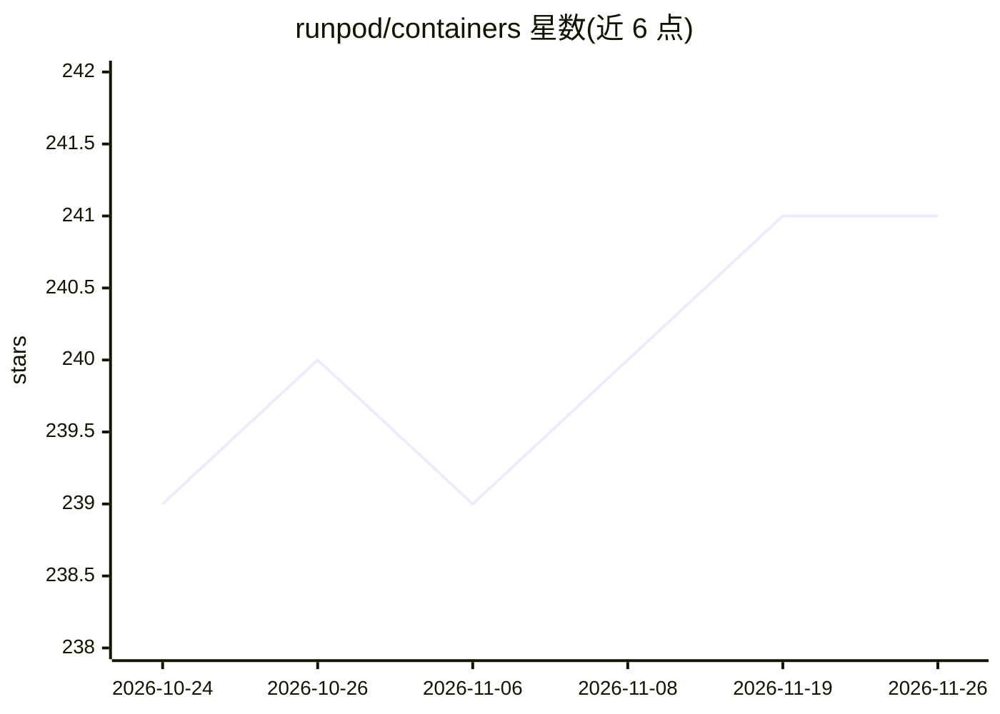

# runpod/containers

⭐ 241 · Python · MIT · 推送 2026-11-25 · [GitHub](https://github.com/runpod/containers) · [官网](https://hub.docker.com/u/runpod) · 组织维护

**为 Runpod 官方模板构建容器镜像的 Dockerfile 集**

存放 Runpod 官方模板所用容器镜像的 Dockerfile，构建后的镜像发布在 Docker Hub。每个容器文件夹附 README 说明端口代理等服务启动信息；所有镜像默认要求 nginx（端口代理）、openssh-server（SSH 访问）、jupyterlab（JupyterLab 访问）三项依赖，沙箱镜像与 k3s 节点镜像为例外。构建通过 Docker Buildx 与 bake 文件管理，由 bake.sh 脚本组合共享版本定义与模板专属 bake 文件。

## 筛选速览

| 维度 | 判定 | 备注 |
|---|---|---|
| AI 角色 | `ai-ecosystem` | LLM/agent 周边工具 |
| 许可风险 | `permissive` | MIT |
| 部署形态 | `self-host` | docker 或自建部署 |
| 模型依赖 | — | README 未给出锁定关系 |
| 硬件要求 | — | 无带数字的原话,不猜 |
| 安装摩擦 | `low` | 无编译、无系统依赖或容器化 |
| 成熟度 | — | 结构信号不足 |

## 能力要点

- 提供 Runpod 官方模板容器镜像的 Dockerfile，镜像发布于 Docker Hub
- 统一依赖规范：nginx 端口代理、openssh-server、jupyterlab
- bake.sh 脚本结合共享版本定义与模板 bake 文件管理构建
- CUDA、Ubuntu、PyTorch 版本兼容性集中在 versions.hcl 维护

## 适用场景

- 为 Runpod 平台定制或重建官方模板容器镜像
- 按集中定义的 CUDA/Ubuntu/PyTorch 版本矩阵构建镜像
- 参考镜像内依赖规范编写符合平台要求的容器

## 场景标签

 · 领域:云计算/容器基础设施

## 证据(README 行号)

> L3: This repository contains the Dockerfiles for the Runpod containers used for our official templates. Built containers
> L11: The following dependencies are required for all images for Runpod platform functionality.

## 星数曲线

2026-10-24 239 → 2026-11-26 241（+2）

---
*卡片 v1 · prompt 1.4 · 生成 2026-11-25 · 置信度 high · 依据 README sha `988156b5161c` · [字段定义](../../DATASET.md)*
