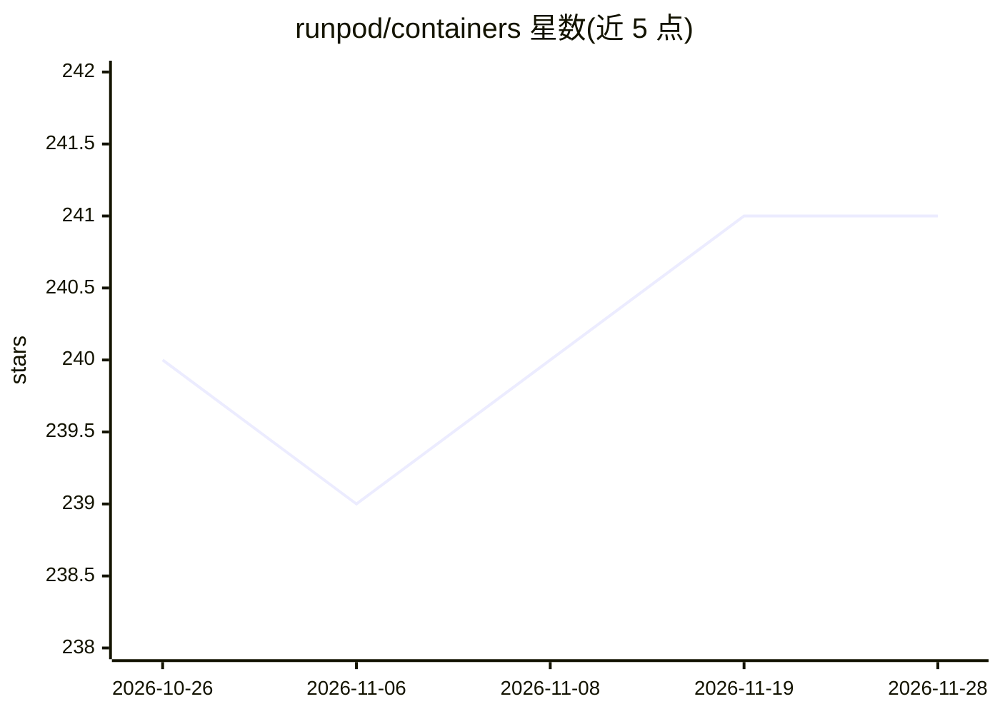

# runpod/containers

⭐ 241 · Python · MIT · 推送 2026-11-27 · [GitHub](https://github.com/runpod/containers) · [官网](https://hub.docker.com/u/runpod) · 组织维护

**为 Runpod 平台官方容器模板提供 Dockerfile 的镜像仓库**

存放 Runpod 官方模板所用容器镜像的 Dockerfiles，构建后的镜像发布在 Docker Hub。所有平台镜像内置 nginx 端口代理、openssh-server SSH 访问与 jupyterlab 访问；sandbox 类镜像通过 Sandbox API 接收命令、k3s-node 镜像运行 k3s agent，均不包含上述服务。构建通过 Docker Buildx 与 bake 脚本管理，CUDA、Ubuntu、PyTorch 的版本兼容集中在 versions.hcl 文件中定义。使用者是需要在 Runpod 平台运行或贡献官方模板的开发者。

## 筛选速览

| 维度 | 判定 | 备注 |
|---|---|---|
| AI 角色 | `ai-ecosystem` | LLM/agent 周边工具 |
| 许可风险 | `permissive` | MIT |
| 部署形态 | `self-host` | docker 或自建部署 |
| 模型依赖 | — | README 未给出锁定关系 |
| 硬件要求 | — | 无带数字的原话,不猜 |
| 安装摩擦 | `low` | 无编译、无系统依赖或容器化 |
| 成熟度 | — | 结构信号不足 |

## 能力要点

- 提供 Runpod 官方模板容器镜像的 Dockerfile 源码
- 内置 nginx 代理、openssh-server、jupyterlab 三类平台依赖
- 通过 bake.sh 脚本与 Buildx 管理构建
- versions.hcl 集中管理 CUDA/Ubuntu/PyTorch 版本兼容

## 适用场景

- 在 Runpod 平台上使用或定制官方 GPU 容器模板
- 向官方模板贡献新镜像或更新版本配置
- 为 stable-diffusion、bittensor 等工作负载获取预构建镜像

## 场景标签

 · 领域:云基础设施/容器化

## 证据(README 行号)

> L3: This repository contains the Dockerfiles for the Runpod containers used for our official templates. Built containers
> L13: The following dependencies are required for all images for Runpod platform functionality.
> L27: This repository uses Docker Buildx with bake files to manage builds.

## 星数曲线

2026-10-26 240 → 2026-11-28 241（+1）

---
*卡片 v1 · prompt 1.4 · 生成 2026-11-26 · 置信度 high · 依据 README sha `6e29d2425108` · [字段定义](../../DATASET.md)*
