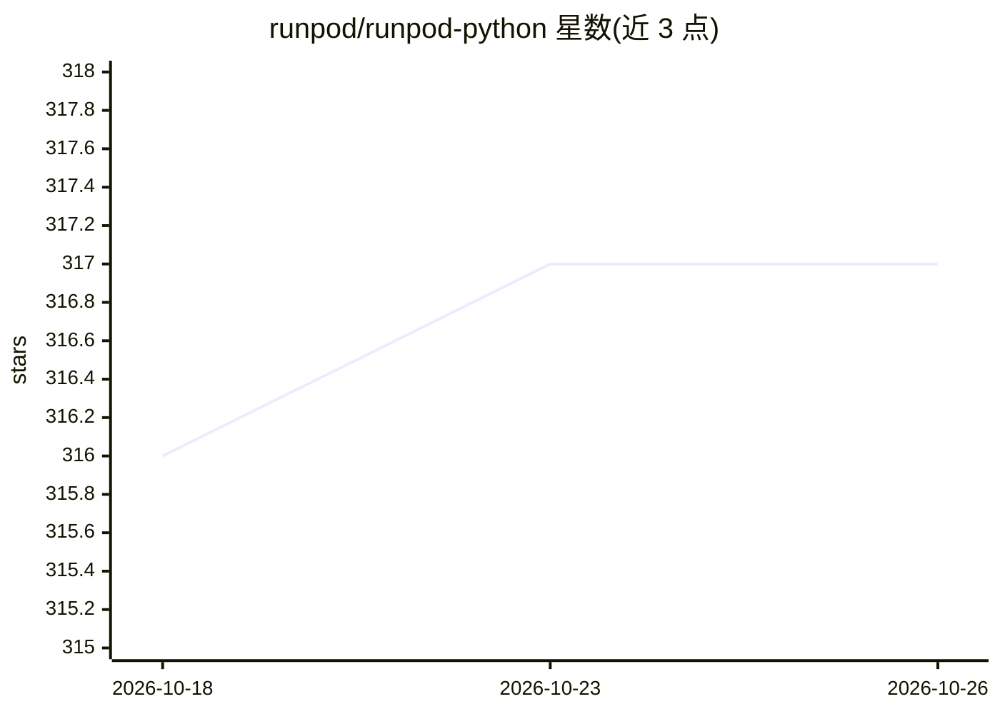

# runpod/runpod-python

⭐ 317 · Python · MIT · 推送 2026-10-24 · [GitHub](https://github.com/runpod/runpod-python) · [官网](https://pypi.org/project/runpod/) · 组织维护

**RunPod 官方 Python SDK：定义 GPU 函数并部署到云端**

RunPod 官方 Python 库，含两部分：一是 API 客户端与 rp CLI，用装饰器方式在 Python 中定义 GPU 函数（App/Model/NetworkVolume 等资源对象），通过 rp flash dev 进行实时开发、rp flash deploy 部署生产端点；二是 Serverless Worker SDK，可将模型封装为自定义端点 API 部署到 RunPod，并支持 --rp_serve_api 本地测试 worker。要求 Python 3.10+，安装包附带 rp CLI，面向使用 RunPod 云 GPU 平台的开发者。

## 筛选速览

| 维度 | 判定 | 备注 |
|---|---|---|
| AI 角色 | `ai-ecosystem` | LLM/agent 周边工具 |
| 许可风险 | `permissive` | MIT |
| 部署形态 | `self-host` | docker 或自建部署 |
| 模型依赖 | — | README 未给出锁定关系 |
| 硬件要求 | — | 无带数字的原话,不猜 |
| 安装摩擦 | `low` | 无编译、无系统依赖或容器化 |
| 成熟度 | — | 结构信号不足 |

## 能力要点

- 装饰器方式定义 GPU 函数并云端运行
- rp CLI 提供登录、实时开发（flash dev）与部署（flash deploy）
- Serverless Worker SDK 可将模型封装为自定义端点 API
- 支持本地测试 worker（--rp_serve_api）

## 适用场景

- 把机器学习模型部署为 RunPod serverless 端点 API
- 在云端以装饰器方式运行 GPU 函数
- 部署前本地调试 RunPod worker

## 场景标签

`推理引擎` · 领域:训练与推理

## 证据(README 行号)

> L3: **Define GPU functions in Python. Run them in the cloud with one decorator.**
> L41: This python package can also be used to create a serverless worker that can be deployed to Runpod as a custom endpo

## 星数曲线

2026-10-18 316 → 2026-10-26 317（+1）

---
*卡片 v1 · prompt 1.4 · 生成 2026-10-21 · 置信度 mid · 依据 README sha `3b0d0609a8f5` · [字段定义](../../DATASET.md)*
