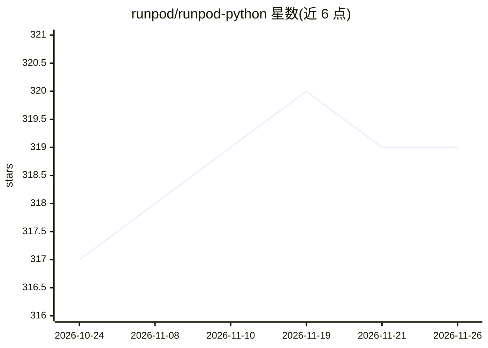

# runpod/runpod-python

⭐ 319 · Python · MIT · 推送 2026-11-25 · [GitHub](https://github.com/runpod/runpod-python) · [官网](https://pypi.org/project/runpod/) · 组织维护

**Runpod 云 GPU 的 Python API 客户端与 Serverless Worker SDK**

Runpod 官方 Python 库，提供两条用法：一是作为 Runpod API 的客户端，通过装饰器在 Python 中定义 GPU 函数并部署到云端运行，附 rp CLI（登录、密钥存储、开发会话、生产端点部署）；二是作为 Serverless Worker SDK，将包含模型定义的 Python 脚本打包为可部署到 Runpod 的自定义端点 API，支持部署前本地测试 worker。需要 Python 3.10+。

## 筛选速览

| 维度 | 判定 | 备注 |
|---|---|---|
| AI 角色 | `ai-ecosystem` | LLM/agent 周边工具 |
| 许可风险 | `permissive` | MIT |
| 部署形态 | `self-host` | docker 或自建部署 |
| 模型依赖 | — | README 未给出锁定关系 |
| 硬件要求 | — | 无带数字的原话,不猜 |
| 安装摩擦 | `low` | 无编译、无系统依赖或容器化 |
| 成熟度 | — | 结构信号不足 |

## 能力要点

- 一个装饰器即可将 Python GPU 函数部署到 Runpod 云端
- 附带 rp CLI：登录认证、密钥存储、流式日志开发会话与部署
- Serverless Worker SDK 可将模型封装为自定义端点 API
- 支持本地测试 worker（--rp_serve_api）再部署

## 适用场景

- 把模型推理脚本封装为 Runpod Serverless API 端点
- 用 Python 直接调用和管理 Runpod 云端 GPU 任务
- 部署前在本地调试 worker 再推上云

## 场景标签

 · 领域:云计算/GPU 基础设施

## 证据(README 行号)

> L3: **Define GPU functions in Python. Run them in the cloud with one decorator.**
> L42: This python package can also be used to create a serverless worker that can be deployed to Runpod as a custom endpo

## 星数曲线

2026-10-24 317 → 2026-11-26 319（+2）

---
*卡片 v1 · prompt 1.4 · 生成 2026-11-25 · 置信度 mid · 依据 README sha `a6f965f5905f` · [字段定义](../../DATASET.md)*
