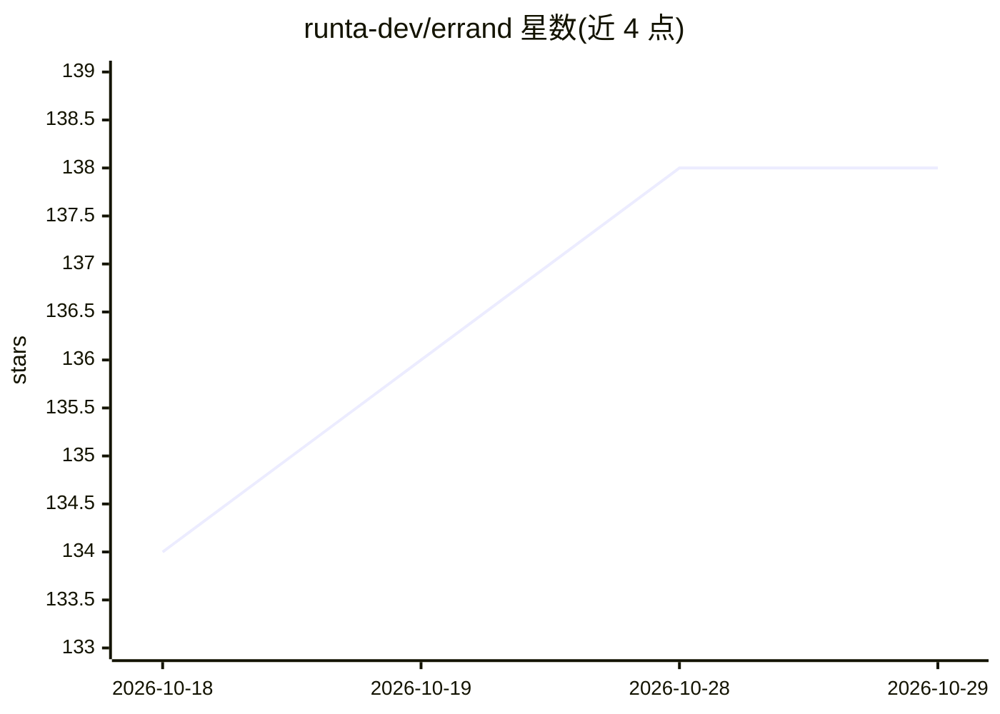

# runta-dev/errand

⭐ 138 · TypeScript · Apache-2.0 · 推送 2026-09-22 · [GitHub](https://github.com/runta-dev/errand) · [官网](https://runerrand.dev/) · 组织维护

**macOS 桌面客户端：管理常驻云端 AI 队友及其专属云电脑**

Electron + React + TypeScript 构建的 macOS（13+，Apple Silicon）桌面应用，作为 Runta Cloud Agents 的客户端：用户创建 agent、下达任务，每个 agent 运行在自己的 Runta Runtime 云电脑中，拥有独立文件与对话历史；应用提供侧边栏团队、对话流、工具活动跟踪与实时桌面查看（noVNC），支持图片附件、浏览器授权与 OS 级凭据加密。执行在云端进行，关闭应用后可回到原工作区。需 Runta 账号与模型访问权限，桌面客户端与 Runta 传输层分离，可按契约接入其他后端。

## 筛选速览

| 维度 | 判定 | 备注 |
|---|---|---|
| AI 角色 | `ai-native` | 本体是模型或模型工具 |
| 许可风险 | `permissive` | Apache-2.0 |
| 部署形态 | `None` |  |
| 模型依赖 | — | README 未给出锁定关系 |
| 硬件要求 | — | 无带数字的原话,不猜 |
| 安装摩擦 | `low` | 无编译、无系统依赖或容器化 |
| 成熟度 | — | 结构信号不足 |

## 能力要点

- 每个 agent 拥有独立 Runta Runtime 云电脑与持久工作区
- 实时桌面查看（noVNC）与工具活动跟踪
- 对话历史持久化，支持追问与图片原生输入
- 浏览器授权 + OS 凭据加密的认证机制

## 适用场景

- 在 Mac 上创建并跟进执行任务的常驻 AI 队友
- 随时回看 agent 的历史对话与完成的工作
- 通过实时桌面观察 agent 在云电脑上的操作过程

## 场景标签

`GUI 自动化` `AI 助手` · 领域:效率与自动化

## 证据(README 行号)

> L7: A desktop home for persistent AI teammates, powered by Runta.
> L19: Create an agent, give it a task, and follow its work from your Mac. Each agent has its own cloud computer, files, a
> L25: Each agent runs in its own Runta Runtime, with a cloud workspace for its files, tools, and ongoing work.

## 星数曲线

2026-10-18 134 → 2026-10-29 138（+4）

---
*卡片 v1 · prompt 1.4 · 生成 2026-10-23 · 置信度 high · 依据 README sha `be31bad2fd08` · [字段定义](../../DATASET.md)*
