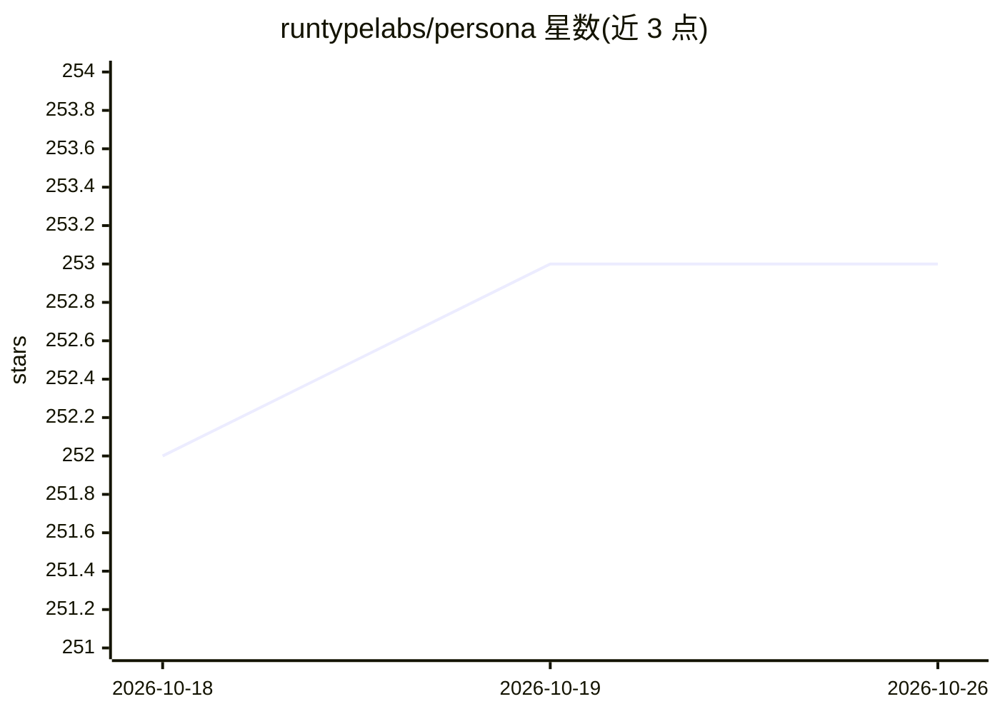

# runtypelabs/persona

⭐ 253 · TypeScript · MIT · 推送 2026-10-25 · [GitHub](https://github.com/runtypelabs/persona) · [官网](https://persona-chat.dev) · 组织维护

**零框架依赖的网站 AI 聊天组件（TypeScript 小组件库）**

用 TypeScript 编写、以原生 JS 渲染的可插拔 AI 聊天挂件，供开发者在任意网站或产品中嵌入 AI 助手界面。支持 SSE 流式响应、多模态内容、语音输入输出、工具调用可视化、审批门控、artifact 渲染、WebMCP 页面工具与插件系统。后端无关：可对接任意 SSE 能力的后端，仓库提供 Vercel Eve、Cloudflare Agents、OpenAI Agents、LangGraph.js、AI SDK 等适配器示例，也可用 clientToken 免后端接入托管 Runtype。提供浮动/停靠/全屏三种布局，npm 安装或 script 标签引入，开发环境要求 Node.js 24 与 pnpm。

## 筛选速览

| 维度 | 判定 | 备注 |
|---|---|---|
| AI 角色 | `ai-ecosystem` | LLM/agent 周边工具 |
| 许可风险 | `permissive` | MIT |
| 部署形态 | `library` | 以包/库形式分发 |
| 模型依赖 | — | README 未给出锁定关系 |
| 硬件要求 | — | 无带数字的原话,不猜 |
| 安装摩擦 | `low` | 无编译、无系统依赖或容器化 |
| 成熟度 | — | 结构信号不足 |

## 能力要点

- 流式聊天、多模态内容（图片/文档）、语音输入输出
- 工具调用可视化、审批门控、artifact 渲染与 WebMCP 页面工具
- 插件系统与主题化，支持 npm 引入或无构建的 script 标签安装
- 后端无关：多种 SDK 适配器示例，或 clientToken 免后端接入

## 适用场景

- 在我的网站/产品里快速嵌入一个 AI 助手聊天窗口
- 为已有 React/Vue 项目叠加一个 AI 前端界面
- 构建支持工具调用与 artifact 展示的 copilot 面板
- 添加带语音输入输出的对话式助手

## 场景标签

`AI 助手` · 领域:对话与助手

## 证据(README 行号)

> L9: Persona gives you a drop-in UI for your AI assistant that works on basically any site or product on the web. It ship
> L63: Persona is designed to be backend-agnostic. You can plug it into any streaming agent or model SDK using the Persona
> L74: - **OpenAI Agents**: Official OpenAI Agents SDK integration.

## 星数曲线

2026-10-18 252 → 2026-10-26 253（+1）

---
*卡片 v1 · prompt 1.4 · 生成 2026-10-22 · 置信度 high · 依据 README sha `ac97f2ff79ba` · [字段定义](../../DATASET.md)*
