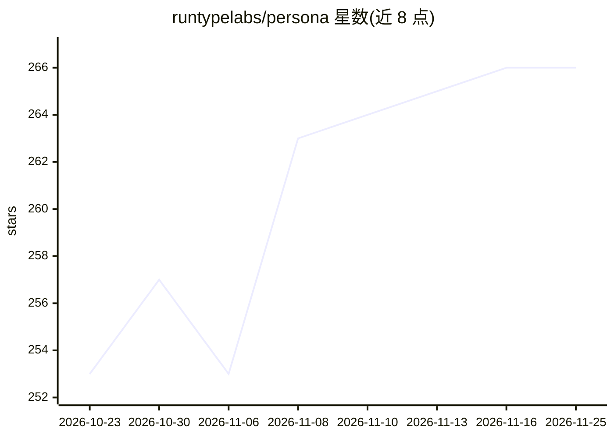

# runtypelabs/persona

⭐ 266 · TypeScript · MIT · 推送 2026-11-22 · [GitHub](https://github.com/runtypelabs/persona) · [官网](https://persona-chat.dev) · 组织维护

**网页端可嵌入 AI 聊天组件库：零框架依赖、WebMCP 原生**

Persona 是一个 TypeScript 编写的 AI 聊天挂件，用 Vanilla JS 渲染、无框架依赖，可作为 drop-in UI 嵌入任意网站，也能叠在 React/Vue 等现有前端之上。功能覆盖 SSE 流式响应、clientToken 直连、WebMCP 页面工具、本地客户端工具、语音输入输出、多模态内容、工具调用可视化、审批门、artifact 渲染与插件系统。后端无关，任何 SSE 流式后端均可接入；提供 Floating/Docked/Fullscreen 三种布局，npm 包与 script 标签两种安装方式。

## 筛选速览

| 维度 | 判定 | 备注 |
|---|---|---|
| AI 角色 | `ai-ecosystem` | LLM/agent 周边工具 |
| 许可风险 | `permissive` | MIT |
| 部署形态 | `library` | 以包/库形式分发 |
| 模型依赖 | — | README 未给出锁定关系 |
| 硬件要求 | — | 无带数字的原话,不猜 |
| 安装摩擦 | `low` | 无编译、无系统依赖或容器化 |
| 成熟度 | — | 结构信号不足 |

## 能力要点

- 零框架依赖的 Vanilla JS 聊天挂件，支持 script 标签免构建嵌入
- 支持 SSE 流式、WebMCP/页面工具、审批门与工具调用可视化
- 语音输入输出（Web Speech API 或 WebSocket 语音服务，含打断与 VAD）
- 后端无关：SSE 协议适配器覆盖多个 agent SDK，Host Matrix 示例可无 API key 运行

## 适用场景

- 在现有网站里快速加一个可定制的 AI 助手对话入口
- 为支持/文档/销售场景配置悬浮、停靠或全屏的 copilot
- 接入自有 agent 后端并可视化工具调用与审批流程
- 给页面添加语音对话与多模态文件上传能力

## 场景标签

`聊天机器人` · 领域:对话与助手

## 证据(README 行号)

> L7: A themeable, pluggable AI chat widget for websites: built in TypeScript with zero framework dependencies. It renders
> L9: Persona gives you a drop-in UI for your AI assistant that works on basically any site or product on the web. It ship
> L64: Persona is designed to be backend-agnostic. You can plug it into any streaming agent or model SDK using the Persona

## 星数曲线

2026-10-23 253 → 2026-11-25 266（+13）

---
*卡片 v1 · prompt 1.4 · 生成 2026-11-25 · 置信度 high · 依据 README sha `ea5a9023b8ea` · [字段定义](../../DATASET.md)*
