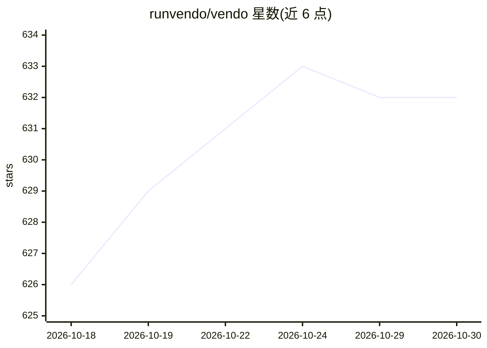

# runvendo/vendo

⭐ 632 · TypeScript · Apache-2.0 · 推送 2026-10-14 · [GitHub](https://github.com/runvendo/vendo) · [官网](https://vendo.run) · 组织维护

**B2B SaaS 内嵌定制层：让客户用自然语言构建功能与自动化**

面向 B2B SaaS 团队的开源定制化层（TypeScript/React/Next.js SDK）。它将产品自身 API 转为工具，让内嵌 agent 以登录用户身份执行操作：从宿主组件与 API 组合实时视图、悬停组件就地改写 UI、创建带逐工具审批的自动化，并支持通过 MCP 让 Claude/ChatGPT/Cursor 等以用户身份调用产品。生成的 UI 在 iframe 沙箱内运行，策略、审批与审计集中于单一执行点；PGlite 零配置存储、生产用 Postgres。npm 安装，Apache-2.0，云端功能需 API key。

## 筛选速览

| 维度 | 判定 | 备注 |
|---|---|---|
| AI 角色 | `ai-ecosystem` | LLM/agent 周边工具 |
| 许可风险 | `permissive` | Apache-2.0 |
| 部署形态 | `library` | 以包/库形式分发 |
| 模型依赖 | — | README 未给出锁定关系 |
| 硬件要求 | — | 无带数字的原话,不猜 |
| 安装摩擦 | `low` | 无编译、无系统依赖或容器化 |
| 成熟度 | — | 结构信号不足 |

## 能力要点

- 读取产品 API 转为工具，agent 以登录用户身份执行
- 生成式 UI：从宿主组件组合视图、就地改写组件
- 策略/审批/授权/审计集中于单一执行点，沙箱隔离
- 支持 MCP 暴露产品、接入任意 AI SDK LanguageModel

## 适用场景

- SaaS 产品内让客户自助构建定制视图与微应用
- 通过对话创建跨工具的自动化流程并逐项审批
- 把产品 API 暴露给 Claude/ChatGPT/Cursor 等 agent 使用

## 场景标签

`Agent 框架` `工作流自动化` · 领域:Agent 开发

## 证据(README 行号)

> L5:  Vendo is for B2B SaaS teams whose customers keep asking for bespoke features. It is an embedded agent : it acts thr
> L57: **You already have an agent** — one tool pack for your AI SDK, Mastra, or homegrown loop.

## 星数曲线

2026-10-18 626 → 2026-10-30 632（+6）

---
*卡片 v1 · prompt 1.4 · 生成 2026-10-21 · 置信度 high · 依据 README sha `d0287364a9d4` · [字段定义](../../DATASET.md)*
