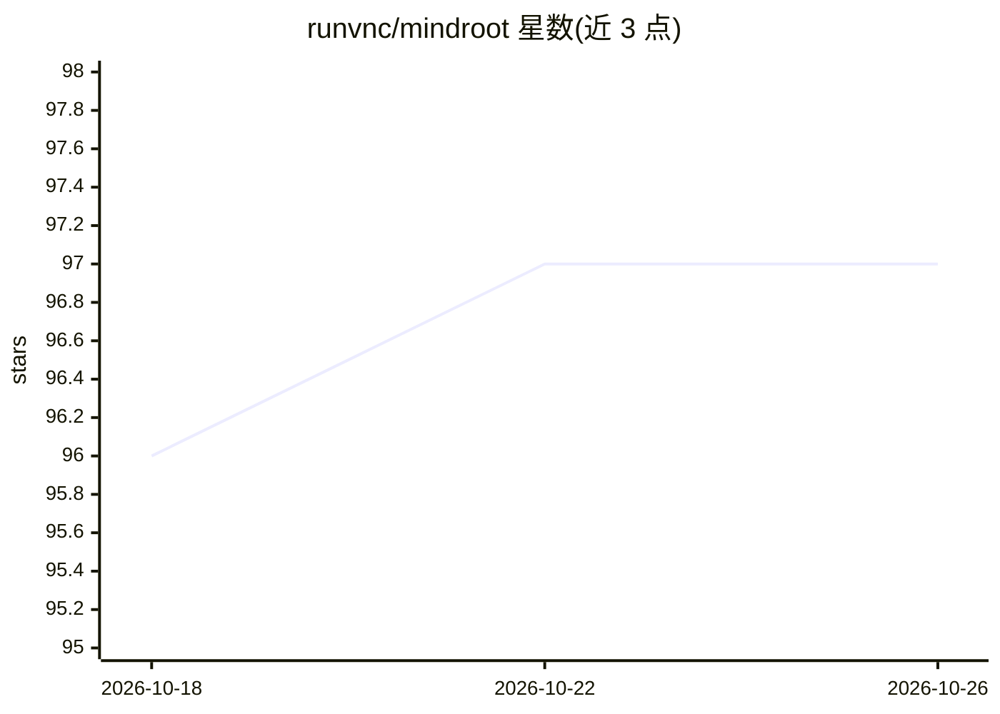

# runvnc/mindroot

⭐ 97 · Python · MIT · 推送 2026-09-30 · [GitHub](https://github.com/runvnc/mindroot) · [官网](https://mindroot.io) · 个人维护

**可自托管的 Python AI agent 平台：插件化构建、运行与嵌入工具型 agent**

面向需要超出聊天封装层的团队的 Python agent 平台，自托管部署，提供 Web UI、REST API、Python SDK（mrsdk）与可扩展插件运行时。核心机制：agent 运行时执行多轮模型调用与工具分发，提供商抽象层支持可替换的本地或托管 LLM/语音/检索提供商，插件以普通 Python 包形式添加命令、服务、FastAPI 路由、模板与 Web Components；命令按 agent 粒度启用，任务响应可含命令执行轨迹。安装方式为 pip install mindroot，需至少一个模型提供商凭据（或本地提供商），部分 Linux 系统需 libgl-dev。

## 筛选速览

| 维度 | 判定 | 备注 |
|---|---|---|
| AI 角色 | `ai-ecosystem` | LLM/agent 周边工具 |
| 许可风险 | `permissive` | MIT |
| 部署形态 | `library` | 以包/库形式分发 |
| 模型依赖 | — | README 未给出锁定关系 |
| 硬件要求 | — | 无带数字的原话,不猜 |
| 安装摩擦 | `low` | 无编译、无系统依赖或容器化 |
| 成熟度 | — | 结构信号不足 |

## 能力要点

- 插件运行时：Python 包可添加工具、服务、FastAPI 路由与 Web Components
- 提供商抽象：可替换本地或托管的 LLM/图像/语音/检索/自动化提供商
- 按 agent 粒度启用命令与服务的权限控制
- 任务响应含最终结果与命令执行轨迹，支持 SSE 流式事件

## 适用场景

- 把 agent 嵌入到自有应用中，通过 REST API 或 Python SDK 调用
- 构建带自定义界面的领域垂直应用而非通用聊天机器人
- 团队内部自动化平台或可定制的 AI 工作区
- RAG 与知识库应用及后台批量处理工作流

## 场景标签

`Agent 框架` `RAG` · 领域:Agent 开发

## 证据(README 行号)

> L7: MindRoot is a self-hostable Python agent platform with a web UI, REST API, Python SDK, and an extensible plugin runt
> L27: |Agent runtime|Multi-turn model execution, tool dispatch, command results, conversation state, and task completion|

## 星数曲线

2026-10-18 96 → 2026-10-26 97（+1）

---
*卡片 v1 · prompt 1.4 · 生成 2026-10-23 · 置信度 high · 依据 README sha `7cd7c63a8155` · [字段定义](../../DATASET.md)*
