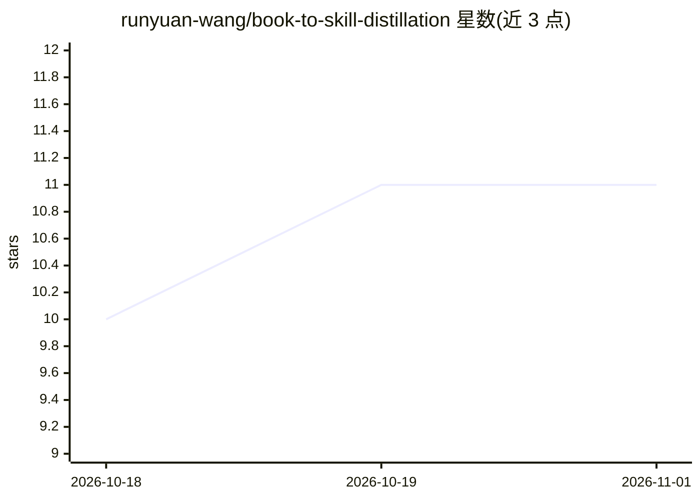

# runyuan-wang/book-to-skill-distillation

⭐ 11 · Python · MIT · 推送 2026-09-27 · [GitHub](https://github.com/runyuan-wang/book-to-skill-distillation) · 个人维护 · 中文 README

**将书籍与长 PDF 蒸馏为 agent 可调用技能的循环工程技能**

面向 LingTai agent 的循环工程（loop engineering）技能：把书籍、长 PDF、EPUB、手册、指南库等线性文本改写为 agent 运行时可调用的分支结构（路由、清单、决策树），而非摘要。机制上通过稀疏路由（ROUTING.yaml）查找相关材料、并行 worker 分发任务、漏例扫描质检、结构化存储记录进度与结果回缓存；支持多书同域蒸馏（source pack、冲突门）。运行需 git clone 后安装 pymupdf 并执行 setup 脚本创建工作区，蒸馏过程按 SKILL.md 手工推进。

## 筛选速览

| 维度 | 判定 | 备注 |
|---|---|---|
| AI 角色 | `ai-ecosystem` | LLM/agent 周边工具 |
| 许可风险 | `permissive` | MIT |
| 部署形态 | `library` | 以包/库形式分发 |
| 模型依赖 | — | README 未给出锁定关系 |
| 硬件要求 | — | 无带数字的原话,不猜 |
| 安装摩擦 | `low` | 无编译、无系统依赖或容器化 |
| 成熟度 | — | 结构信号不足 |

## 能力要点

- 线性文本改写为 agent 运行时的分支可调用结构（路由/清单/决策树）
- 稀疏路由 + 并行 worker 分发 + 漏例扫描质检的循环机制
- 多书同域蒸馏：source pack、source anchor、冲突门与统一图索引
- 版权/隐私/时效/Token 预算四项运行纪律（敏感声明标记刷新）

## 适用场景

- 把专业书籍或指南库转化为 AI agent 的运行时技能
- 多本书同域蒸馏并保留来源、记录矛盾
- 为依赖现行法律、价格等易变信息的技能设置刷新标记

## 场景标签

`RAG` · 领域:知识与检索

## 证据(README 行号)

> L17: This is a **loop engineering** skill for LingTai agents. It converts books, long PDFs, EPUBs, manuals, guideline co
> L21: This skill IS a loop. You don't prompt the agent to "read chapter 3 and take notes." You design a system that:
> L37: This skill encodes a repeatable workflow for the *rewriting* step: taking linear human text and turning it into the

## 星数曲线

2026-10-18 10 → 2026-11-01 11（+1）

---
*卡片 v1 · prompt 1.4 · 生成 2026-11-01 · 置信度 low · 依据 README sha `74fbe4f572b4` · [字段定义](../../DATASET.md)*
