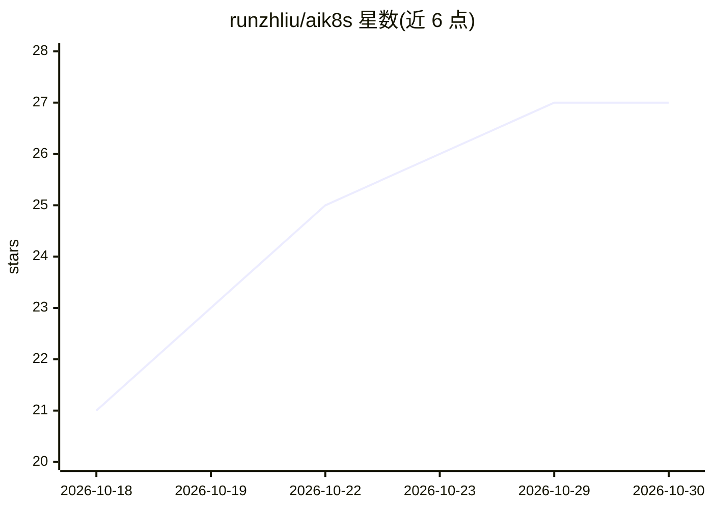

# runzhliu/aik8s

⭐ 27 · Python · 推送 2026-10-29 · [GitHub](https://github.com/runzhliu/aik8s) · [官网](https://aik8s.run/) · 个人维护 · 中文 README

**面向平台工程师的 AI/LLM on Kubernetes 基础设施知识库**

个人维护的工程文档站点（中英双语），记录 Kubernetes、GPU 调度、分布式训练、LLM 推理、RAG、Agent 与生产运维的架构分析、部署记录、性能实测与排障过程。面向平台工程师、SRE、训练与模型服务及 Agent 平台团队。模型实测保留版本、硬件与原始结果；站点基于 Markdown 与 Zensical 构建，支持本地预览与双语构建发布，订阅支持 RSS/Atom。

## 筛选速览

| 维度 | 判定 | 备注 |
|---|---|---|
| AI 角色 | `ai-knowledge` | 知识聚合/清单类 |
| 许可风险 | `none` | — |
| 部署形态 | `library` | 以包/库形式分发 |
| 模型依赖 | — | README 未给出锁定关系 |
| 硬件要求 | — | 无带数字的原话,不猜 |
| 安装摩擦 | `low` | 无编译、无系统依赖或容器化 |
| 成熟度 | — | 结构信号不足 |

## 能力要点

- 覆盖 K8s 稳定性、GPU 调度、LLM 推理、训练与 Agent 平台等专题的工程笔记
- 模型实测保留版本、硬件、请求条件与原始结果
- 中英文文章一一对应，双语构建与发布流程完整
- 站点提供搜索、时间线、RSS/Atom 订阅与 Giscus 评论

## 适用场景

- 查 GPU/LLM 基础设施的部署、性能测试与排障记录
- 参考 K8s 多集群稳定性与调度优化的工程经验
- 了解 Agent 沙箱与企业 Agent 平台的方案选型

## 场景标签

`知识库管理` · 领域:知识与检索

## 证据(README 行号)

> L1: # AI/LLM on Kubernetes 基础设施知识库
> L7: 面向平台工程师、SRE、训练、模型服务与 Agent 平台团队的工程文档。
> L9: 内容围绕 Kubernetes、GPU/LLM 基础设施和 Agent 工程展开：既有架构与源码分析，也有部署、性能测试、故障排查和迁移记录。模型实测尽量保留版本、硬件、请求条件、原始结果与监控截图；社区方案、线上指标观察和本地实验

## 星数曲线

2026-10-18 21 → 2026-10-30 27（+6）

---
*卡片 v1 · prompt 1.4 · 生成 2026-10-26 · 置信度 mid · 依据 README sha `2308576c6fd4` · [字段定义](../../DATASET.md)*
