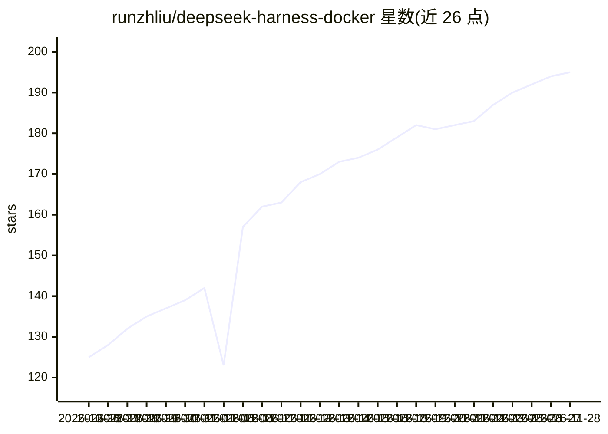

# runzhliu/deepseek-harness-docker

⭐ 195 · JavaScript · MIT · 推送 2026-11-23 · [GitHub](https://github.com/runzhliu/deepseek-harness-docker) · 个人维护 · 中文 README

**为 DeepSeek Harness 提供云上 Docker/K8s 部署封装**

将官方 DSH npm 发行物（@deepseek-ai/dsh）封装为可复现的 Docker 运行环境，提供 Dockerfile、Compose、Rootless Podman 与 Helm Chart 四种部署方式，默认附带 Web UI、非 root Node.js 24 运行时与可视 Chromium/noVNC 桌面。镜像固定官方版本基线并通过 Cordis 配置 patch 覆盖容器监听地址，不修改 DSH 源码。默认仅回环访问，本机单用户开发定位，LAN 访问需显式叠加 Caddy HTTPS+Basic Auth overlay，不支持公网暴露。

## 筛选速览

| 维度 | 判定 | 备注 |
|---|---|---|
| AI 角色 | `ai-ecosystem` | LLM/agent 周边工具 |
| 许可风险 | `permissive` | MIT |
| 部署形态 | `self-host` | docker 或自建部署 |
| 模型依赖 | — | README 未给出锁定关系 |
| 硬件要求 | — | 无带数字的原话,不猜 |
| 安装摩擦 | `low` | 无编译、无系统依赖或容器化 |
| 成熟度 | `idea` | |

## 能力要点

- Docker Hub / GHCR 双架构镜像，支持 Compose、Rootless Podman、Helm StatefulSet 部署
- 非 root UID 1000、只读根文件系统、cap_drop ALL、tini 信号处理等容器加固
- 配置/凭据/会话/存储持久化到 dsh-home 卷，容器可重建而状态保留
- 无 Landlock 内核时可选 bubblewrap 沙箱后端（仅 Compose）

## 适用场景

- 在云上或服务器按任务部署独立的企业 Agent 实例
- 用 Compose/Helm 快速搭建带可视浏览器的 DeepSeek Harness 运行环境
- 需要在无 Landlock 内核（如 NAS）上运行 Agent 沙箱

## 场景标签

 · 领域:AI Agent 基础设施/容器化部署

## 证据(README 行号)

> L15: 本项目将官方 DSH npm 发行物封装为可复现的 Docker 运行环境，为通过 Kubernetes 部署和管理独立的 Agent 实例提供基础。默认提供 Web UI、非 root 的 Node.js 24 运行时与可视 C
> L67: DeepSeek Harness 不是 DeepSeek 模型权重或推理引擎，而是一套 TypeScript AI Agent Runtime。它把模型适配、会话、工具、权限、工作区、插件、Web UI 与 Headless 入口

## 星数曲线

2026-10-26 125 → 2026-11-28 195（+70）

---
*卡片 v1 · prompt 1.4 · 生成 2026-11-26 · 置信度 high · 依据 README sha `1df081547be0` · [字段定义](../../DATASET.md)*
