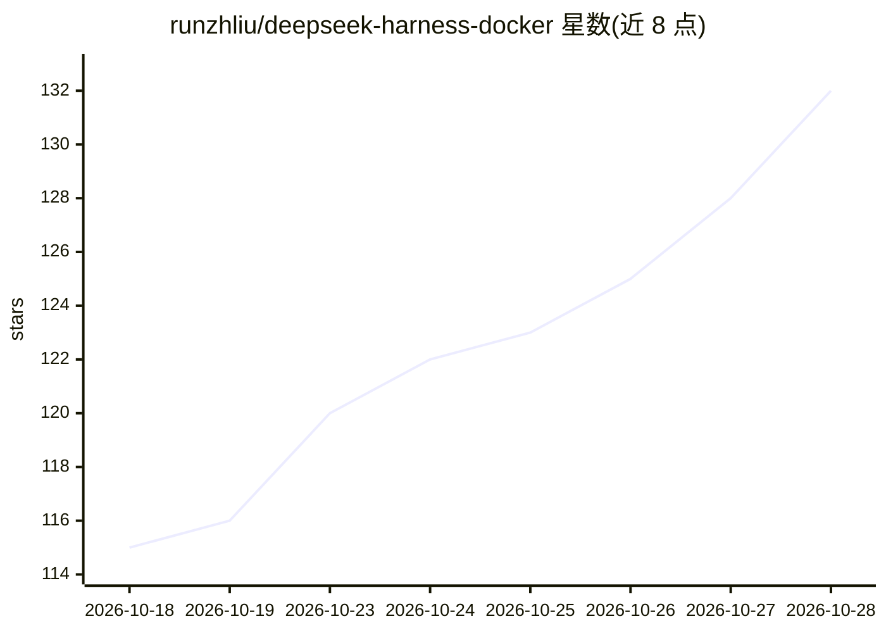

# runzhliu/deepseek-harness-docker

⭐ 132 · Shell · MIT · 推送 2026-10-26 · [GitHub](https://github.com/runzhliu/deepseek-harness-docker) · 个人维护 · 中文 README

**DeepSeek Harness 的社区 Docker/K8s 封装：双架构镜像与多方式部署**

将官方 @deepseek-ai/dsh（TypeScript AI Agent Runtime）的 npm 发行物装入非 root Node.js 24 容器的社区打包项目，不修改上游源码。提供 Docker Hub/GHCR 双架构镜像、Docker Compose、Rootless Podman overlay 与 Helm StatefulSet 单副本部署，内置可视 Chromium/noVNC 桌面、可选插件市场与 Caddy HTTPS 局域网入口，另带 Headless CLI。默认仅回环发布端口，基线固定 0.2.1-rc.2（上游预发布），不发布漂移 latest 标签。

## 筛选速览

| 维度 | 判定 | 备注 |
|---|---|---|
| AI 角色 | `ai-ecosystem` | LLM/agent 周边工具 |
| 许可风险 | `permissive` | MIT |
| 部署形态 | `self-host` | docker 或自建部署 |
| 模型依赖 | locked-api |  |
| 硬件要求 | — | 无带数字的原话,不猜 |
| 安装摩擦 | `low` | 无编译、无系统依赖或容器化 |
| 成熟度 | `idea` | |

## 能力要点

- 双架构镜像 + Compose/Rootless Podman/Helm 三种部署路径
- 非 root、只读根文件系统、tini 信号转发与 DSH_HOME 状态持久化分离
- 内置 Chromium + noVNC 桌面，官方 Playwright MCP Browser Use attach 同一浏览器
- 可选 Caddy HTTPS + Basic Auth 局域网入口，公网暴露不在支持范围

## 适用场景

- 在容器或 Kubernetes 中运行 DeepSeek Harness Web UI 而不污染宿主环境
- 为 coding agent 提供带可视浏览器桌面和开发工具链的隔离运行时
- 通过 Headless Profile 在 CI 或自动化场景运行 DSH

## 场景标签

`编码 Agent` · 领域:编码与开发

## 证据(README 行号)

> L63: DeepSeek Harness 不是 DeepSeek 模型权重或推理引擎，而是一套 TypeScript AI Agent Runtime。它把模型适配、会话、工具、权限、工作区、插件、Web UI 与 Headless 入口
> L15: 默认运行官方 `@deepseek-ai/dsh` 的 Web UI，将官方 npm 发行物装入非 root 的 Node.js 24 运行时，集成可视 Chromium/noVNC 桌面，并提供可选的插件市场和受保护局域网入口。

## 星数曲线

2026-10-18 115 → 2026-10-28 132（+17）

---
*卡片 v1 · prompt 1.4 · 生成 2026-10-23 · 置信度 high · 依据 README sha `ca83070626dc` · [字段定义](../../DATASET.md)*
