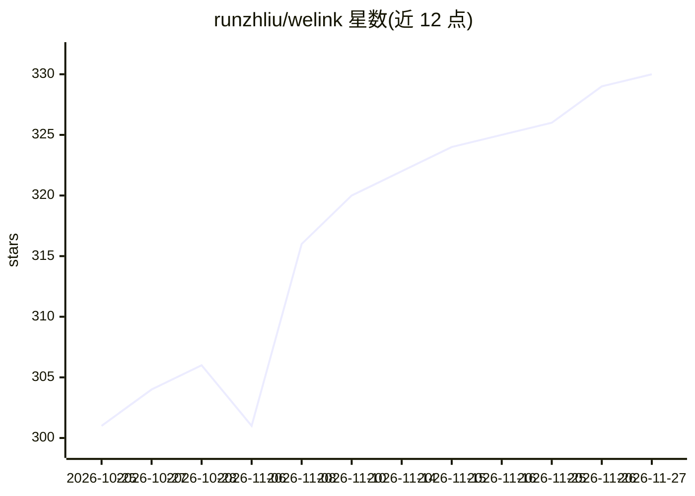

# runzhliu/welink

⭐ 330 · TypeScript · AGPL-3.0 · 推送 2026-11-16 · [GitHub](https://github.com/runzhliu/welink) · [官网](https://welink.click) · 个人维护 · 中文 README

**本地化的微信聊天记录 AI 分析与对话模拟平台**

面向个人用户的微信聊天数据分析平台，读取本地聊天数据库后提供 AI 分析、AI 分身（学习联系人说话风格并模拟对话）、AI 群聊模拟、跨联系人问答、关系报告与群聊画像等功能；另含 21 个统计/Lab 小工具与定时分析任务。AI 分析支持三种检索模式（全量、FTS5+向量 RAG、单日聚合），接入 25+ LLM 提供商，内置 MCP 服务器供 Claude Code 查询。v0.4.0 提供 SFT 工作台，可在 Mac MLX 或 NVIDIA GPU 环境训练 LoRA Adapter。本地优先设计，云端模型使用时数据会发送到所选服务商。

## 筛选速览

| 维度 | 判定 | 备注 |
|---|---|---|
| AI 角色 | `ai-native` | 本体是模型或模型工具 |
| 许可风险 | `viral` | AGPL-3.0 |
| 部署形态 | `desktop` | 安装包/桌面程序 |
| 模型依赖 | local-ok | 支持本地模型 |
| 硬件要求 | — | 无带数字的原话,不猜 |
| 安装摩擦 | `low` | 无编译、无系统依赖或容器化 |
| 成熟度 | — | 结构信号不足 |

## 能力要点

- AI 分身：从私聊+共同群聊学习联系人说话风格并模拟对话
- 三种检索模式：全量上下文、FTS5+语义向量 RAG、时光机单日分析
- 接入 25+ LLM 提供商，含 Ollama 本地离线部署
- SFT 工作台支持 MLX 与 LLaMA-Factory Worker 训练 LoRA Adapter

## 适用场景

- 分析自己与好友或群聊的聊天记录并直接提问
- 用 AI 分身模拟某个联系人的对话风格
- 本地离线分析不想上传云端的聊天数据
- 在 Claude Code 里通过 MCP 自然语言查询微信数据

## 场景标签

`数据分析` `RAG` `微调` `文档问答` · 领域:效率与自动化

## 证据(README 行号)

> L29: 你的微信聊天记录里，藏着你和每个人关系最真实的样子。WeLink 把这些数据交给 AI 来读——不只是统计图表，而是能让你直接提问、得到洞察：
> L123: 技术原理：LLM Agent 模式——第一步 LLM 解析问题意图（提取关键词/时间范围），第二步自动调用搜索/日历 API 收集数据，第三步 LLM 基于真实数据生成回答。每次提问仅消耗 ~4000 token。
> L306: ### 支持的 LLM 提供商（25+）

## 星数曲线

2026-10-25 301 → 2026-11-27 330（+29）

---
*卡片 v1 · prompt 1.4 · 生成 2026-11-25 · 置信度 high · 依据 README sha `d0eac8dec2ec` · [字段定义](../../DATASET.md)*
