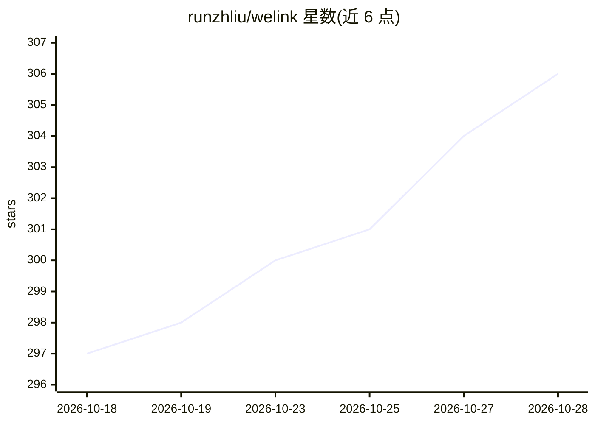

# runzhliu/welink

⭐ 306 · TypeScript · AGPL-3.0 · 推送 2026-10-19 · [GitHub](https://github.com/runzhliu/welink) · [官网](https://welink.click) · 个人维护 · 中文 README

**本地化微信聊天数据分析 AI 平台：分析、画像与 AI 分身**

面向个人用户的微信聊天记录分析平台，数据全部留在本地不上传。核心功能包括：AI 分身（学习联系人聊天风格模拟对话）、AI 群聊模拟、跨联系人 AI 问答（LLM Agent 模式，三步生成回答）、对话式 AI 分析（全量/FTS5+向量 RAG/时光机三种检索）、记忆提炼、21 个创意实验室工具、互动小说、定时任务、每日简报等。支持 25+ LLM 提供商（含 Ollama 本地部署），提供 MCP 服务器与 Skill 炼化（导出 Claude Code/Cursor 等 Skill 及 LoRA 训练集）。AI 文生图支持 4 个 provider。以 Docker 镜像与桌面端（Windows/macOS）形式分发。

## 筛选速览

| 维度 | 判定 | 备注 |
|---|---|---|
| AI 角色 | `ai-native` | 本体是模型或模型工具 |
| 许可风险 | `viral` | AGPL-3.0 |
| 部署形态 | `desktop` | 安装包/桌面程序 |
| 模型依赖 | local-ok | 支持本地模型 |
| 硬件要求 | — | 无带数字的原话,不猜 |
| 安装摩擦 | `low` | 无编译、无系统依赖或容器化 |
| 成熟度 | — | 结构信号不足 |

## 能力要点

- AI 分身从私聊+群聊学习联系人风格并模拟对话
- LLM Agent 模式的跨联系人问答与三种检索模式（含 FTS5+向量 RAG）
- 25+ LLM 提供商接入，含 Ollama 完全离线本地部署
- Skill 炼化导出 Claude Code/Cursor/Codex Skill 及 LoRA 训练集（自动脱敏）
- 内置 MCP 服务器供 Claude Code 查询微信数据

## 适用场景

- 把微信聊天记录导入本地，用自然语言询问关系与聊天洞察
- 用 AI 分身模拟失去联系的亲友的对话风格
- 生成好友画像、群聊画像、聊天 DNA 等可分享卡片
- 把联系人聊天风格炼化成 AI 编程工具的 Skill 或 LoRA 训练集

## 场景标签

`数据分析` `RAG` · 领域:效率与自动化

## 证据(README 行号)

> L29: 你的微信聊天记录里，藏着你和每个人关系最真实的样子。WeLink 把这些数据交给 AI 来读——不只是统计图表，而是能让你直接提问、得到洞察：
> L59: 让 AI 学习任何联系人的聊天风格，**模拟和 TA 对话——像真的在和 TA 聊天一样**。

## 星数曲线

2026-10-18 297 → 2026-10-28 306（+9）

---
*卡片 v1 · prompt 1.4 · 生成 2026-10-22 · 置信度 high · 依据 README sha `71d184dcbb95` · [字段定义](../../DATASET.md)*
