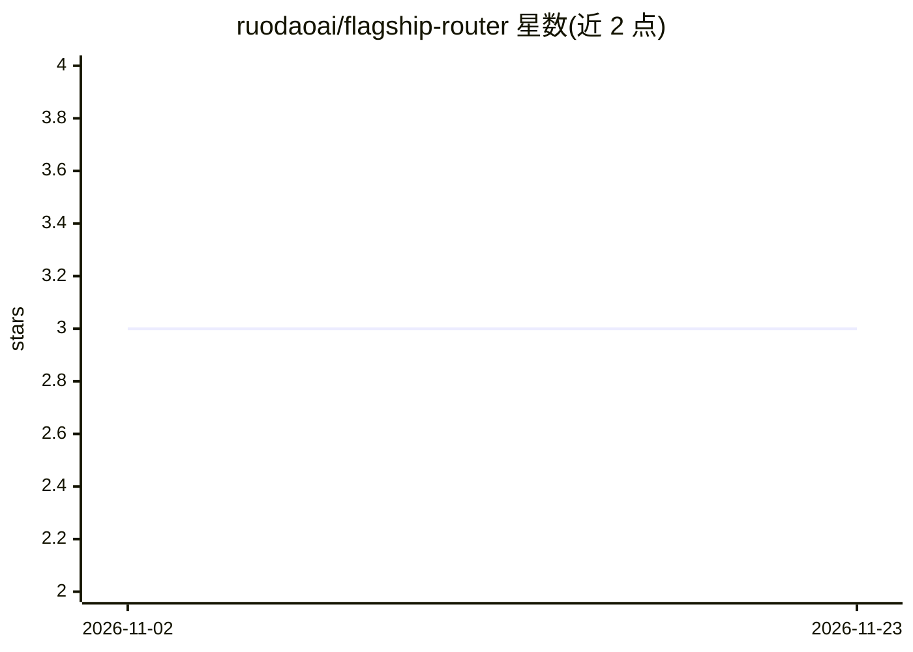

# ruodaoai/flagship-router

⭐ 3 · JavaScript · MIT · 推送 2026-10-30 · [GitHub](https://github.com/ruodaoai/flagship-router) · [官网](https://ruodao.com/plugin-market/items/flagship-router) · 组织维护 · 中文 README

**把免费模型一键接入若道 Agent 的本地 OpenAI 兼容网关插件**

若道桌面端的功能插件，围绕上游 FlagshipRouter（基于 9router）网关封装安装与运维流程：后台下载源码、npm install、Next.js 构建、启动进程（默认 127.0.0.1:20128）、自动登录控制台生成并校验 API Key；合并 /v1/models 与后台 catalog 输出带就绪状态和上下文窗口的模型清单，勾选后写入 config.toml 注册为若道 Agent 的模型提供方。提供 doctor 环境自检、日志查看、端口占用自动换号、卸载与数据清除；支持 GitHub 镜像加速与离线 ZIP/目录安装，构建失败时复用已装依赖。

## 筛选速览

| 维度 | 判定 | 备注 |
|---|---|---|
| AI 角色 | `ai-ecosystem` | LLM/agent 周边工具 |
| 许可风险 | `permissive` | MIT |
| 部署形态 | `library` | 以包/库形式分发 |
| 模型依赖 | — | README 未给出锁定关系 |
| 硬件要求 | — | 无带数字的原话,不猜 |
| 安装摩擦 | `low` | 无编译、无系统依赖或容器化 |
| 成熟度 | — | 结构信号不足 |

## 能力要点

- 一键完成源码下载、构建、启动、API Key 生成与校验，无需命令行
- 合并 /v1/models 与后台 catalog 的模型清单（就绪状态、上下文窗口）
- doctor 自检逐项检查 Node 版本、连通性、Key、模型数，零费用
- 支持 GitHub 镜像加速与本地 ZIP/目录离线安装，免 VS C++ 工具链

## 适用场景

- 给若道 Agent 一键接入一批免费额度模型
- 不想手动 clone、装依赖、建 Key、配环境变量的用户
- 需要本地网关自检与排障日志的开发者
- 离线环境下从本地源码构建网关

## 场景标签

`模型网关` · 领域:Agent 开发

## 证据(README 行号)

> L3: > **免费模型的入口，不该是一个需要手动配环境的技术活。** FlagshipRouter 是社区里少见的「本地 OpenAI 兼容网关 + 控制台」，把一批免费模型聚合成一个标准 API。可惜原版要自己 clone、装依赖、bu
> L45: |🔌 **接入 Agent**|勾选模型后注册为模型提供方（`wire_api = "responses"`），写入 `config.toml`，重启仍在|

## 星数曲线

2026-11-02 3 → 2026-11-23 3（+0）

---
*卡片 v1 · prompt 1.4 · 生成 2026-11-21 · 置信度 high · 依据 README sha `dc75af859432` · [字段定义](../../DATASET.md)*
