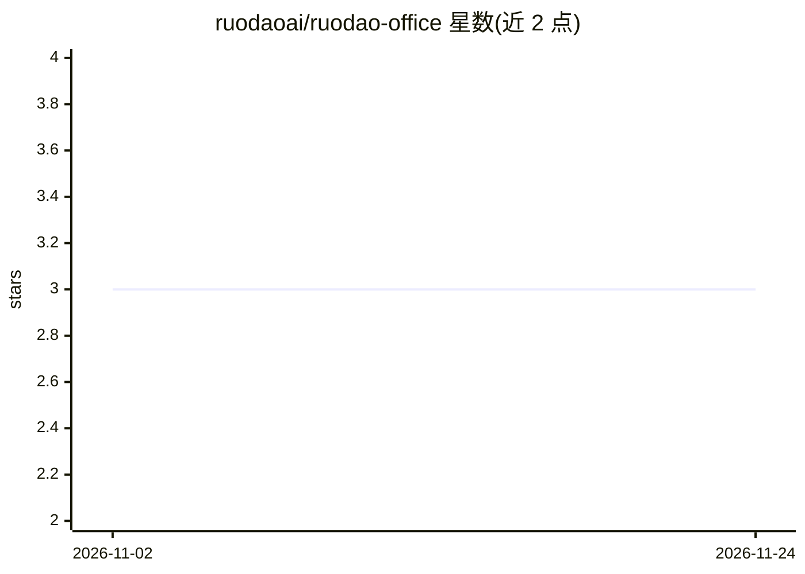

# ruodaoai/ruodao-office

⭐ 3 · TypeScript · MIT · 推送 2026-11-01 · [GitHub](https://github.com/ruodaoai/ruodao-office) · [官网](https://ruodao.com) · 个人维护 · 中文 README

**本地优先的 Windows 办公套件，含 AI 助手**

面向 Windows 桌面的本地优先办公套件，覆盖文档、表格、PDF 工具箱、双链笔记、格式转换与 AI 助手六个模块，数据存本机 IndexedDB，支持 JSON 整包备份迁移，无账号体系。AI 助手需自行配置接入方式（API Key 或本机 Ollama），未配置时部分离线功能仍可用；多人协作为可选功能，需自建 WebSocket 服务。目前仅打包 Windows x64 版本，macOS/Linux 桌面包在开发计划中。

## 筛选速览

| 维度 | 判定 | 备注 |
|---|---|---|
| AI 角色 | `ai-enhanced` | 去掉 AI 部分产品仍成立 |
| 许可风险 | `permissive` | MIT |
| 部署形态 | `desktop` | 安装包/桌面程序 |
| 模型依赖 | local-ok | 支持本地模型 |
| 硬件要求 | — | 无带数字的原话,不猜 |
| 安装摩擦 | `low` | 无编译、无系统依赖或容器化 |
| 成熟度 | — | 结构信号不足 |

## 能力要点

- 六大模块：文档/表格/PDF 工具箱/双链笔记/格式转换/AI 助手
- PDF 离线 OCR（tesseract.js）、电子签章、压缩在本地完成
- AI 接入方式可选：DeepSeek、任意 OpenAI 兼容接口、本机 Ollama、若道账号
- 基于 Yjs 的多人协作，走自建 WebSocket 服务

## 适用场景

- 断网环境下写文档、算表格、处理 PDF
- 批量转换图片/PDF/文档/表格格式且文件不出本机
- 选中文本调用自配模型做摘要、改写、翻译、续写
- 双链笔记组织资料并查看关系图谱

## 场景标签

`AI 助手` `知识库管理` `OCR` · 领域:对话与助手

## 证据(README 行号)

> L23: 若道办公是一套**本地优先（local-first）**的桌面办公套件。它把平时散落在七八个网站里的活——写文档、算表格、处理 PDF、记笔记、转格式——收进同一个安静的工作台，并且默认**不联网也能用**。
> L43: |✨ **AI 助手**|接 DeepSeek / 任意 OpenAI 兼容接口 / 本机 Ollama；摘要、改写、翻译、续写、提取要点|

## 星数曲线

2026-11-02 3 → 2026-11-24 3（+0）

---
*卡片 v1 · prompt 1.4 · 生成 2026-11-21 · 置信度 high · 依据 README sha `abaf308c4c4c` · [字段定义](../../DATASET.md)*
