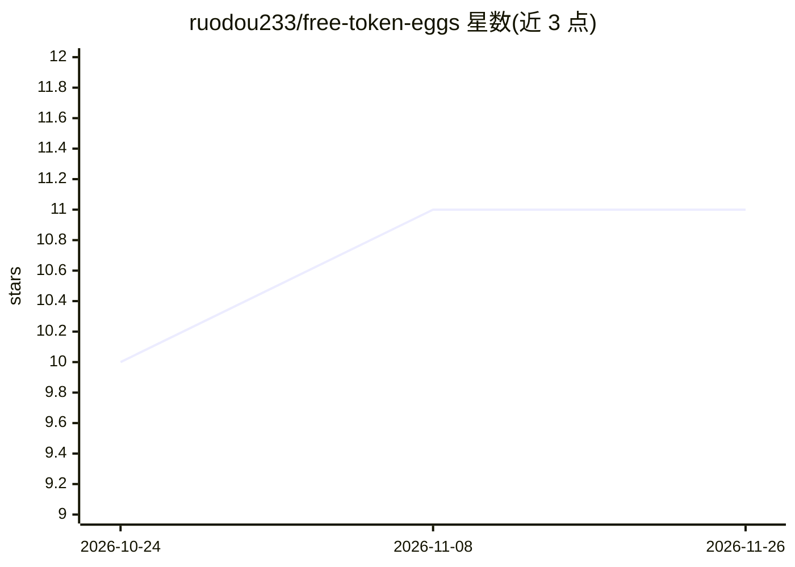

# ruodou233/free-token-eggs

⭐ 11 · Python · MIT · 推送 2026-11-19 · [GitHub](https://github.com/ruodou233/free-token-eggs) · 个人维护 · 中文 README

**帮开发者筛选并领取值得领的免费 AI 模型额度**

以 Codex/Claude 技能（skill）形式提供的免费 AI 额度检索工具：维护高优先级平台、额度与有效期的清单（references/platforms.md），执行时实时核验活动是否有效；支持按 API 类别、应用积分、代金券等使用方式筛选，并通过 Python 脚本批量打开领取入口。只收录第一梯队模型，国内外平台均覆盖；用户可替换默认 JSON 配置中的作者邀请链接为自己的链接。

## 筛选速览

| 维度 | 判定 | 备注 |
|---|---|---|
| AI 角色 | `ai-knowledge` | 知识聚合/清单类 |
| 许可风险 | `permissive` | MIT |
| 部署形态 | `None` |  |
| 模型依赖 | — | README 未给出锁定关系 |
| 硬件要求 | — | 无带数字的原话,不猜 |
| 安装摩擦 | `low` | 无编译、无系统依赖或容器化 |
| 成熟度 | — | 结构信号不足 |

## 能力要点

- 清单集中在 references/platforms.md，执行时实时核验额度与有效期
- Python 脚本按优先级批量打开领取入口（--tier 参数）
- 支持自定义邀请链接 JSON 配置，同名平台自动替换
- 安装为 Codex/Claude 技能目录下的 skill

## 适用场景

- 给小项目找可领取的免费 API 额度
- 想试用别家模型时查找体验额度入口
- 不接 API、只想找有免费积分的 AI 应用

## 场景标签

`精选清单` · 领域:学习与行业

## 证据(README 行号)

> L3: Find worthwhile free LLM API credits and AI trials, with eligibility, expiry dates, and claim links checked.
> L5: 免费额度到处都是，找半天、领一圈，模型还不好用？这个 skill 帮你挑值得领的免费 AI token，查清条件、找到入口。**只收 DeepSeek V4.1 同级（第一梯队）的模型**，国内外都覆盖，太蠢的大模型不收录。
> L16: 高优先级平台、具体额度和有效期集中在 `references/platforms.md`，执行时实时核验。

## 星数曲线

2026-10-24 10 → 2026-11-26 11（+1）

---
*卡片 v1 · prompt 1.4 · 生成 2026-11-18 · 置信度 high · 依据 README sha `44c9be02e2d5` · [字段定义](../../DATASET.md)*
