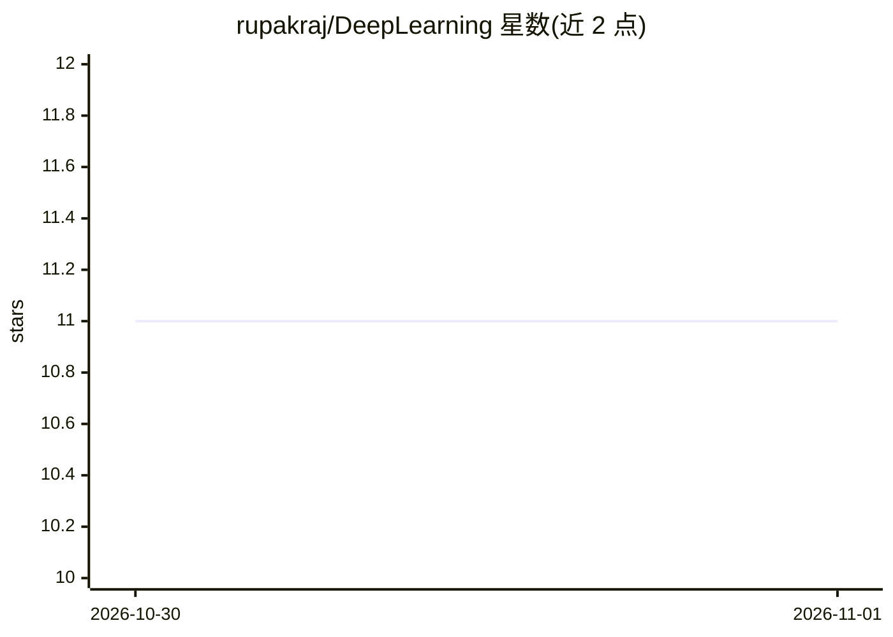

# rupakraj/DeepLearning

⭐ 11 · Jupyter Notebook · GPL-3.0 · 推送 2026-10-29 · [GitHub](https://github.com/rupakraj/DeepLearning) · 个人维护

**课堂教学用深度学习 Jupyter notebook 集合（12 个主题）**

个人维护的深度学习教学脚本仓库：以 PyTorch 为主要框架，用 Jupyter notebook 讲解梯度下降局限、自适应学习率（AdaGrad/RMSProp/Adam）、CNN、AlexNet、批归一化、自编码器与表示学习、Word2Vec、嵌入检索、GRU 序列模型、神经 N-Gram 语言模型等 12 个主题，配套玩具示例与 FashionMNIST/CIFAR-10/MNIST 等数据集实验。提供 venv + requirements.txt 的环境搭建步骤，说明在 VS Code 中以 Jupyter 内核运行。

## 筛选速览

| 维度 | 判定 | 备注 |
|---|---|---|
| AI 角色 | `ai-knowledge` | 知识聚合/清单类 |
| 许可风险 | `viral` | GPL-3.0 |
| 部署形态 | `library` | 以包/库形式分发 |
| 模型依赖 | — | README 未给出锁定关系 |
| 硬件要求 | — | 无带数字的原话,不猜 |
| 安装摩擦 | `low` | 无编译、无系统依赖或容器化 |
| 成熟度 | — | 结构信号不足 |

## 能力要点

- 12 个主题 notebook 覆盖优化、CNN、正则化、表示学习与序列模型
- 以 PyTorch 实现并配玩具示例与公开数据集实验
- 包含嵌入检索（EmbeddingGemma）与跨语言尼泊尔语查询示例

## 适用场景

- 按主题逐步学习深度学习基础概念与实现
- 课堂上跟随运行与修改教学 notebook
- 参考表示学习与语言模型的入门实验代码

## 场景标签

`教程课程` · 领域:学习与行业

## 证据(README 行号)

> L3: Collection of scripts I use in Classroom
> L23: |SN|Topic|Script|

## 星数曲线

2026-10-30 11 → 2026-11-01 11（+0）

---
*卡片 v1 · prompt 1.4 · 生成 2026-11-01 · 置信度 mid · 依据 README sha `8e06f3ac5b9d` · [字段定义](../../DATASET.md)*
