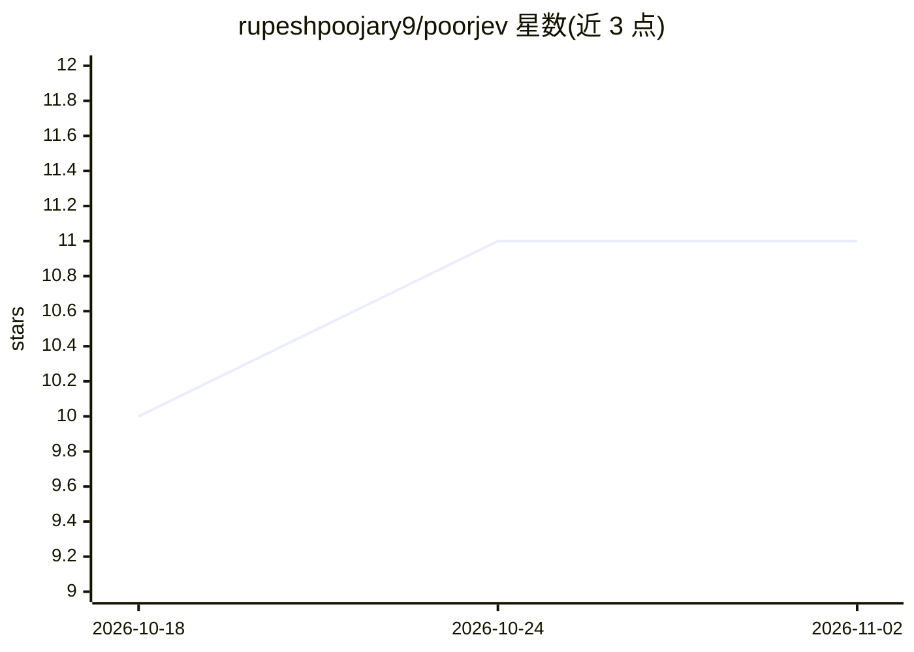

# rupeshpoojary9/poorjev

⭐ 11 · Python · MIT · 推送 2026-09-21 · [GitHub](https://github.com/rupeshpoojary9/poorjev) · 个人维护

**本地离线的 LLM 应用决策层：类型化决策加校准置信度**

面向 LLM 应用的"System One"决策层库：提供 Choice（分类/路由）、Score（等级评分）、Noul（是否门控）三种类型化原语，返回值恒在声明的选项集内。默认后端用小型 NLI 模型批量打分，一次性下载约 400MB 后完全离线运行，无需 API key 或 GPU。通过温度缩放（5 折交叉验证）与共形阈值做置信度校准（随附评测集 ECE 0.170→0.071），支持风险预算下的弃答升级。另附 MCP server 供 Claude Code 作为本地工具调用。README 同时列出与 Jev/von/Laya 的交叉基准及自身局限（高基数分类校准不佳）

## 筛选速览

| 维度 | 判定 | 备注 |
|---|---|---|
| AI 角色 | `ai-native` | 本体是模型或模型工具 |
| 许可风险 | `permissive` | MIT |
| 部署形态 | `library` | 以包/库形式分发 |
| 模型依赖 | — | README 未给出锁定关系 |
| 硬件要求 | `cpu-ok` | |
| 安装摩擦 | `low` | 无编译、无系统依赖或容器化 |
| 成熟度 | — | 结构信号不足 |

## 能力要点

- Choice/Score/Noul 三种类型化决策原语，输出恒在声明选项集内
- 温度缩放+共形阈值校准置信度，随附评测集 ECE 0.170→0.071（5 折交叉验证）
- 默认本地 NLI 后端，离线运行、无需 API key，支持风险预算弃答
- 提供 MCP server，Claude Code/Desktop 可将其作为本地决策工具

## 适用场景

- 为工单路由、意图分类、严重度评分等结构化决策提供带校准置信度的本地方案
- 在 agent 执行前对高风险工具调用做门控判断
- 私有数据或离线环境中替代托管 API 做快速决策

## 场景标签

 · 领域:LLM 基础设施/决策层

## 证据(README 行号)

> L3:  The poor man's Jev. An open source, local-first "System One" decision layer for LLM apps: typed decisions with prov
> L124: |`Choice(options)`|classification, routing|winning option, per-option probabilities, calibrated confidence|
> L126: |`Noul(statement)`|yes/no gates, guardrails|`P(true)`, thresholded to a bool|

## 星数曲线

2026-10-18 10 → 2026-11-02 11（+1）

---
*卡片 v1 · prompt 1.4 · 生成 2026-11-01 · 置信度 high · 依据 README sha `152b35aa81d3` · [字段定义](../../DATASET.md)*
