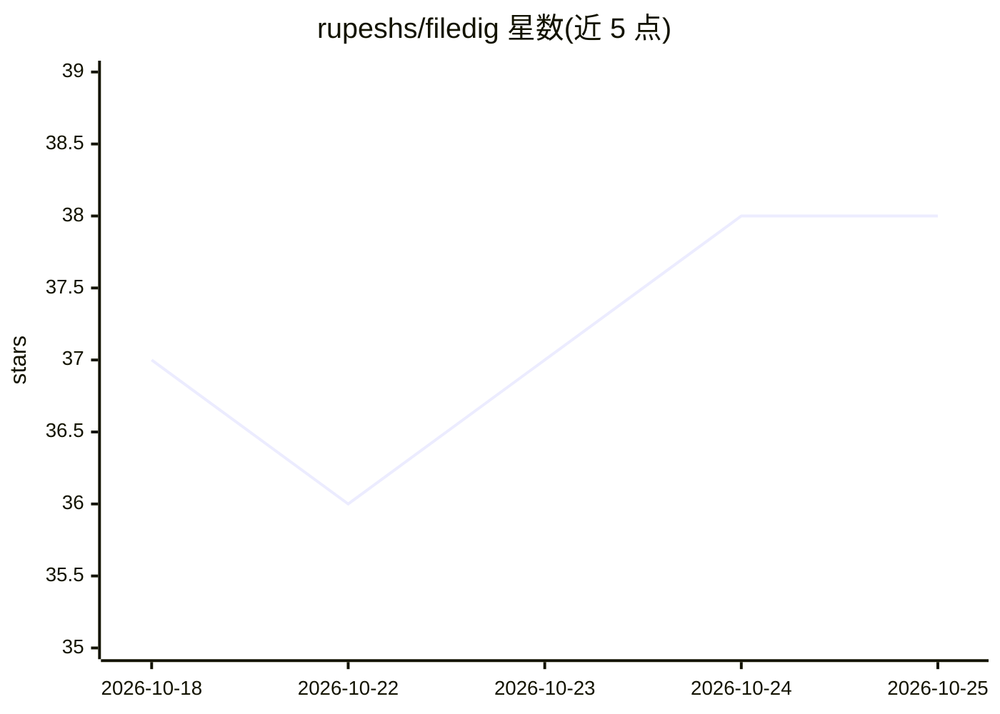

# rupeshs/filedig

⭐ 38 · Rust · MIT · 推送 2026-10-11 · [GitHub](https://github.com/rupeshs/filedig) · 个人维护

**Windows 本地语义文件搜索：按内容找文档与图片**

面向 Windows 用户的本地桌面搜索工具：对文本、PDF（按页）和图片建立同一向量索引，用自然语言按含义检索，并与关键词精确匹配结果做倒数排名融合。通过 llama.cpp 在本机运行 EmbeddingGemma 2 嵌入模型，文本与图片映射到同一 768 维空间，故文字查询可匹配图片；NVIDIA GPU 可加速并有 CPU 回退。数据不出本机，SQLite 存储索引。限制：仅 Windows、无实时文件监控、无 OCR、结果上限 48 条、大库全量向量驻留内存。

## 筛选速览

| 维度 | 判定 | 备注 |
|---|---|---|
| AI 角色 | `ai-native` | 本体是模型或模型工具 |
| 许可风险 | `permissive` | MIT |
| 部署形态 | `desktop` | 安装包/桌面程序 |
| 模型依赖 | local-ok | 支持本地模型 |
| 硬件要求 | — | 无带数字的原话,不猜 |
| 安装摩擦 | `medium` | 含编译或系统依赖之一 |
| 成熟度 | — | 结构信号不足 |

## 能力要点

- 文本/图片统一向量索引，自然语言按含义检索
- 语义与关键词结果用 RRF 融合，PDF 结果定位到匹配页
- 通过 llama.cpp 运行 EmbeddingGemma 2，NVIDIA GPU 加速、CPU 回退
- 便携运行、增量索引、可随时暂停/恢复

## 适用场景

- 用一句话在大量文档和照片中找到内容相符的文件
- 离线私有环境下的本地语义搜索
- 查找 PDF 中某段话并直接打开到对应页

## 场景标签

`语义搜索` · 领域:知识与检索

## 证据(README 行号)

> L20: It runs EmbeddingGemma 2 on your own machine
> L26: - 🔎 **Search by meaning** across text and images in one index

## 星数曲线

2026-10-18 37 → 2026-10-25 38（+1）

---
*卡片 v1 · prompt 1.4 · 生成 2026-10-25 · 置信度 mid · 依据 README sha `b337396a628c` · [字段定义](../../DATASET.md)*
