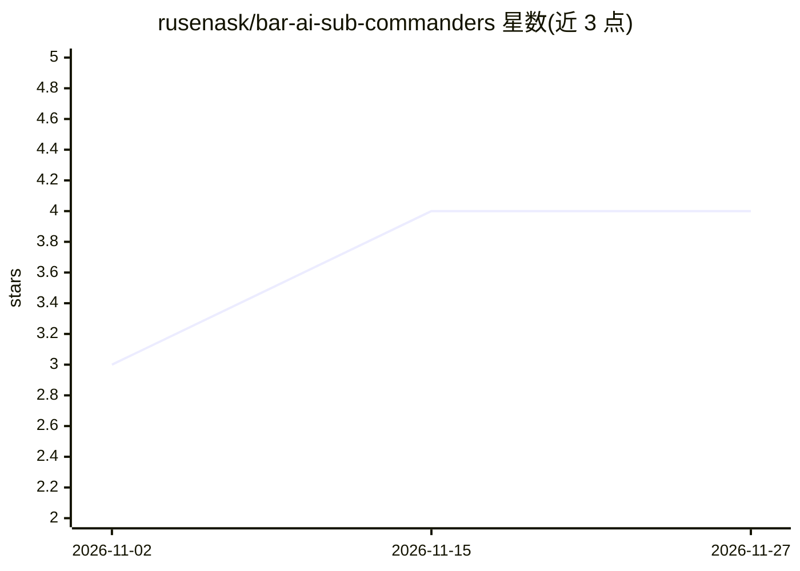

# rusenask/bar-ai-sub-commanders

⭐ — · [GitHub]() · 个人维护

**给 Beyond All Reason 玩家的自治子指挥官挂件，可选 LLM 策略师**

一组 BAR 用户挂件：玩家把建造者、工厂或战斗小队划给子指挥官，指定角色（经济/防御/陆军/情报/空军）、区域与资源姿态，由 Lua 规则引擎每半秒执行单位级建造与作战；可选的 LLM 策略师经 opencode 与 MCP 桥接，每约 30 秒调整姿态、角色、区域并向玩家发消息，任何支持工具调用的 OpenAI 兼容模型均可。子指挥官间共享计划与互助请求。无 LLM 时纯规则运行；规则-only 尚未能稳定击败 BARbarian medium。

## 筛选速览

| 维度 | 判定 | 备注 |
|---|---|---|
| AI 角色 | `ai-enhanced` | 去掉 AI 部分产品仍成立 |
| 许可风险 | `viral` | — |
| 部署形态 | `self-host` | docker 或自建部署 |
| 模型依赖 | — | README 未给出锁定关系 |
| 硬件要求 | — | 无带数字的原话,不猜 |
| 安装摩擦 | `low` | 无编译、无系统依赖或容器化 |
| 成熟度 | — | 结构信号不足 |

## 能力要点

- 角色化子指挥官：建造、生产、作战均在自有区域内自主进行
- LLM 策略师可选：opencode 会话 + 角色技能 + 地图图像，通过工具调整配置
- 规则引擎承担全部单位级决策，模型延迟不阻塞游戏
- 支持 Autopilot 整队代打与本机对战模式（make play-vs）

## 适用场景

- 把经济/防御/空军分区委托给 AI 管理，自己专注主战线
- 用自然语言下达指令让策略师调整子指挥官
- 本机开设 1v1 对抗由 Autopilot 驱动的 bot

## 场景标签

 · 领域:游戏/RTS 自动化

## 证据(README 行号)

> L5: role and a spending posture, and it works on its own. Optionally put an **LLM strategist** on top that
> L22: - **AI strategist** (optional): one opencode agent session per sub-commander, with
> L38: The rules engine in the widget does all unit-level work, every half second, with no AI involved. The

## 星数曲线

2026-11-02 3 → 2026-11-27 4（+1）

---
*卡片 v1 · prompt 1.4 · 生成 2026-11-21 · 置信度 high · 依据 README sha `af50fec63f67` · [字段定义](../../DATASET.md)*
