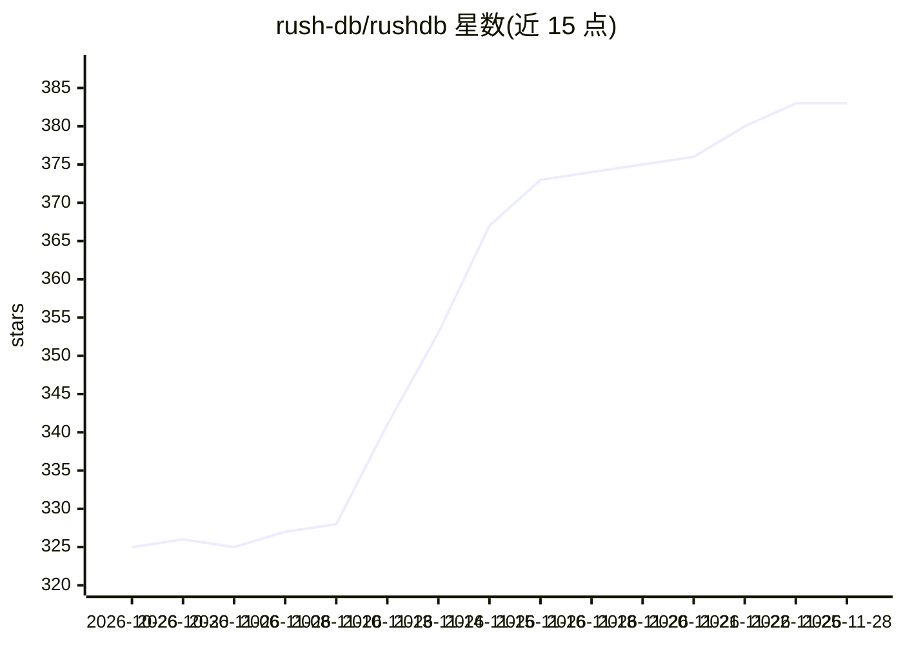

# rush-db/rushdb

⭐ 383 · Rust · Apache-2.0 · 推送 2026-11-25 · [GitHub](https://github.com/rush-db/rushdb) · [官网](https://rushdb.com) · 组织维护

**面向 AI 应用的数据库：图、向量与分析共存，Agent 先读实时 schema**

RushDB 是一个用 Rust 编写的单二进制数据库引擎，将嵌套 JSON、CSV、SQL、Cypher 等写入数据存为带类型关联的记录，同一份记录支持图查询、向量/BM25 混合搜索与聚合。每次写入自动更新标签、字段与值的 schema 目录，Agent 查询前可先读取，避免猜测字段名。支持 HTTP、PostgreSQL wire、Bolt、gRPC 与 MCP 接入，提供 Python/TypeScript SDK、MCP 服务器与多种自托管部署方式；RushDB Cloud 为可选托管版。Windows 原生不支持，需 WSL 2 或 Docker。

## 筛选速览

| 维度 | 判定 | 备注 |
|---|---|---|
| AI 角色 | `ai-ecosystem` | LLM/agent 周边工具 |
| 许可风险 | `permissive` | Apache-2.0 |
| 部署形态 | `self-host` | docker 或自建部署 |
| 模型依赖 | — | README 未给出锁定关系 |
| 硬件要求 | — | 无带数字的原话,不猜 |
| 安装摩擦 | `low` | 无编译、无系统依赖或容器化 |
| 成熟度 | — | 结构信号不足 |

## 能力要点

- 单 Rust 二进制提供图、向量/BM25 混合搜索与聚合
- 每次写入更新的 live schema 目录，供 Agent 查询前读取
- 支持 PostgreSQL wire、Bolt、gRPC、HTTP 与 MCP 多种协议
- 提供 LangChain/LlamaIndex、MCP 服务器与 Agent memory 集成

## 适用场景

- 为 Agent 存储并检索带来源的记忆记录
- 构建企业知识库与 RAG，事实引用底层记录
- 在应用中做分面搜索与混合排序检索
- 让 Agent 先读 schema 再生成 SQL/Cypher 查询

## 场景标签

`Agent 记忆` `向量数据库` · 领域:Agent 开发

## 证据(README 行号)

> L5:  The database for AI
> L7: **Graph, vector and analytics on the same records. Every write keeps a live schema of labels, fields and values, so 
> L23: fields, types and values that exist, so an agent queries real fields. Connect

## 星数曲线

2026-10-26 325 → 2026-11-28 383（+58）

---
*卡片 v1 · prompt 1.4 · 生成 2026-11-25 · 置信度 high · 依据 README sha `2dd84a2df4d0` · [字段定义](../../DATASET.md)*
