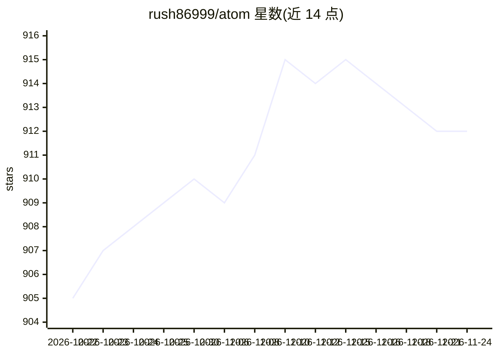

# rush86999/atom

⭐ 912 · Python · AGPL-3.0 · 推送 2026-11-24 · [GitHub](https://github.com/rush86999/atom) · 个人维护

**自托管、带治理机制的业务 AI Agent 平台**

开源且自托管的 AI Agent 平台，面向企业：用户向 Agent 教授业务规则、字段映射与上下文，由人工审核输出，并提供权限、策略检查、审批检查点与审计记录等治理机制。运行模式为单租户本地工作区，支持 BYOK 模型与本地 OpenAI 兼容端点，示例无需模型即可运行。覆盖报价、发票、工作簿编辑等演示工作流，长期通用自主能力仍为开发目标。

## 筛选速览

| 维度 | 判定 | 备注 |
|---|---|---|
| AI 角色 | `ai-ecosystem` | LLM/agent 周边工具 |
| 许可风险 | `viral` | AGPL-3.0 |
| 部署形态 | `None` |  |
| 模型依赖 | local-ok | 支持本地模型 |
| 硬件要求 | — | 无带数字的原话,不猜 |
| 安装摩擦 | `low` | 无编译、无系统依赖或容器化 |
| 成熟度 | — | 结构信号不足 |

## 能力要点

- 教学机制：保存业务规则与修正，新工作自动采用已接受的教训
- 治理执行路径：人工审批检查点、来源可追溯、审批不可绕过
- 可等待/可恢复的持久化任务，支持跨重启续作
- BYOK 模型与本地 OpenAI 兼容端点配置

## 适用场景

- 根据价目表生成报价文档并审核溯源
- 发票与采购/收货记录核对
- 多 Agent 协作处理需要审批的业务流程

## 场景标签

`多智能体` `工作流自动化` · 领域:Agent 开发

## 证据(README 行号)

> L41: - **Bring your own model.** Configure a supported provider or local
> L89: actions and authority. Atom brings AI governance into the execution path through

## 星数曲线

2026-10-22 905 → 2026-11-24 912（+7）

---
*卡片 v1 · prompt 1.4 · 生成 2026-11-24 · 置信度 high · 依据 README sha `e4c1434de260` · [字段定义](../../DATASET.md)*
