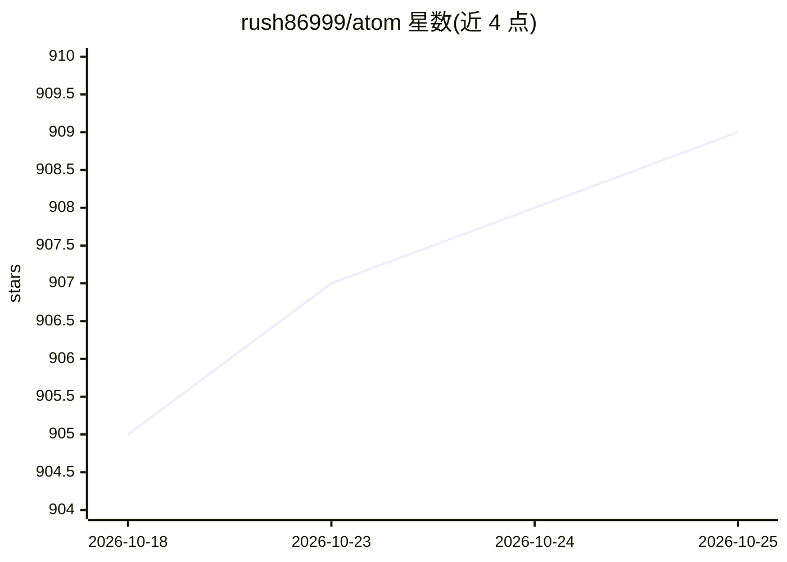

# rush86999/atom

⭐ 909 · Python · AGPL-3.0 · 推送 2026-10-25 · [GitHub](https://github.com/rush86999/atom) · 个人维护

**给企业的自托管治理型 AI agent 团队平台，自动执行业务流程**

面向企业团队的自托管开源 AI agent 平台：销售、客服、财务、工程等专业 agent 以自然语言接受委派，端到端执行例行工作。关键机制包括 4 级成熟度模型（STUDENT→AUTONOMOUS，需验证通过次数方可晋升）、默认开启的后置条件预言机核验（区分自报与外部验证）、沙箱隔离与完整审计。支持 BYOK 或本地模型（Ollama/OpenAI 兼容服务器），16+ LLM 提供商成本感知路由，46+ 业务集成（Salesforce、Slack、QuickBooks 等）。AGPL v3，通过 git clone + make 从源码运行，另提供 Docker 与 DigitalOcean 一键部署入口。限制：LLM 功能需自备 API key 或本地推理服务。

## 筛选速览

| 维度 | 判定 | 备注 |
|---|---|---|
| AI 角色 | `ai-native` | 本体是模型或模型工具 |
| 许可风险 | `viral` | AGPL-3.0 |
| 部署形态 | `None` |  |
| 模型依赖 | local-ok | 支持本地模型 |
| 硬件要求 | — | 无带数字的原话,不猜 |
| 安装摩擦 | `low` | 无编译、无系统依赖或容器化 |
| 成熟度 | — | 结构信号不足 |

## 能力要点

- 4 级 agent 成熟度模型，晋升需经结果验证（非自报）
- 默认开启的后置条件预言机核验 mutating action，区分自报/外部验证置信度
- 沙箱层（文件系统范围、工具白名单、资源上限、kill-run）与完整审计
- 16+ LLM 提供商成本感知路由，支持 Ollama/vLLM/llama.cpp 等本地推理

## 适用场景

- 让 agent 团队自动处理线索研究、发票对账、工单分流等例行业务
- 在自有基础设施上部署带审批门与审计的 agent 工作流
- 通过对话让 agent 构建/修改工作流，无需拖拽配置

## 场景标签

`工作流自动化` · 领域:效率与自动化

## 证据(README 行号)

> L20: Atom is an open-source, self-hosted **AI agent workforce** — a team of specialty agents (sales, support, finance, e
> L22: **Agents that earn trust, not assume it.** Atom's agents don't just respond to commands — they operate autonomously
> L67: |*"When a lead comes in HubSpot, research the company, score it, create an Asana task for the rep, and ping Slack"*

## 星数曲线

2026-10-18 905 → 2026-10-25 909（+4）

---
*卡片 v1 · prompt 1.4 · 生成 2026-10-21 · 置信度 high · 依据 README sha `00fb57150d72` · [字段定义](../../DATASET.md)*
