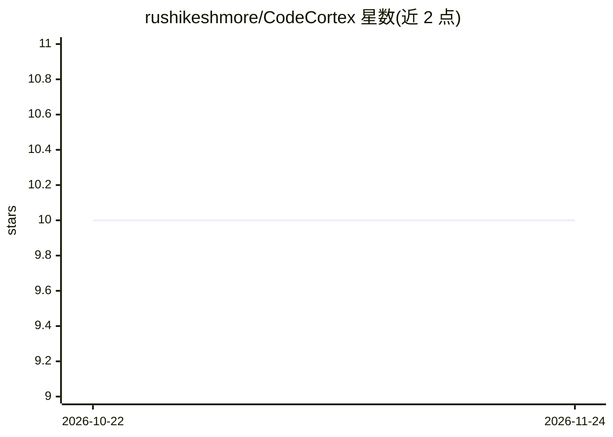

# rushikeshmore/CodeCortex

⭐ 10 · TypeScript · MIT · 推送 2026-04-21 · [GitHub](https://github.com/rushikeshmore/CodeCortex) · [官网](https://codecortex-ai.vercel.app) · 个人维护

**为 AI 编码 agent 预构建代码库知识的 MCP 服务**

以 MCP 服务器与 CLI 形式提供的代码库知识层：通过 tree-sitter 解析 27 种语言的结构（符号、导入、调用），结合宿主 LLM 生成语义描述，构建架构、依赖、时间耦合、风险评分等六层知识，存于仓库内 .codecortex/ 扁平文件，并将上下文注入 CLAUDE.md、.cursorrules 等 agent 配置文件。通过 5 个 MCP 工具、3 个资源与 2 个提示词向 agent 供知识，git hook 在提交时自动更新。需要 Node 20 或 22，Node 24 尚不支持。

## 筛选速览

| 维度 | 判定 | 备注 |
|---|---|---|
| AI 角色 | `ai-ecosystem` | LLM/agent 周边工具 |
| 许可风险 | `permissive` | MIT |
| 部署形态 | `library` | 以包/库形式分发 |
| 模型依赖 | — | README 未给出锁定关系 |
| 硬件要求 | — | 无带数字的原话,不猜 |
| 安装摩擦 | `low` | 无编译、无系统依赖或容器化 |
| 成熟度 | — | 结构信号不足 |

## 能力要点

- tree-sitter + 宿主 LLM 混合抽取，覆盖 27 种语言
- git 共变分析揭示零 import 的隐性文件耦合与风险评分
- 知识注入 CLAUDE.md / .cursorrules 等配置文件，agent 无需额外设置即可读取
- 5 个 MCP 工具（项目概览/依赖图/符号查询/变更耦合/编辑前风险简报）+ 13 个 CLI 命令

## 适用场景

- 让编码 agent 在首次提示即获得项目架构与风险地图，减少探索性工具调用
- 编辑前获取文件共变警告与 bug 历史简报
- 长期多会话开发中保持代码库知识随提交自动更新

## 场景标签

 · 领域:开发者工具/AI 编码基础设施

## 证据(README 行号)

> L3: Persistent codebase knowledge layer for AI agents. Pre-builds architecture, dependencies, coupling, and risk knowled
> L143: |`codecortex serve`|Start MCP server (stdio transport)|
> L156: **Hybrid extraction:** tree-sitter native N-API for structure (symbols, imports, calls across 27 languages) + host

## 星数曲线

2026-10-22 10 → 2026-11-24 10（+0）

---
*卡片 v1 · prompt 1.4 · 生成 2026-11-19 · 置信度 high · 依据 README sha `b7e969cf9d4c` · [字段定义](../../DATASET.md)*
