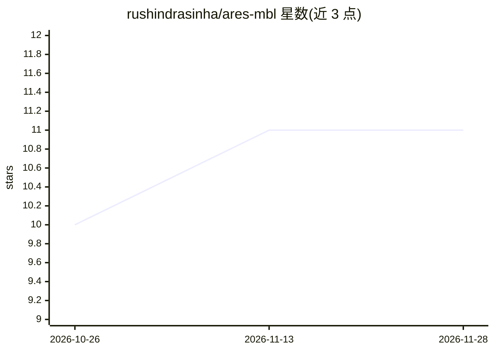

# rushindrasinha/ares-mbl

⭐ 11 · MIT · 推送 2026-05-01 · [GitHub](https://github.com/rushindrasinha/ares-mbl) · 个人维护

**面向 AI 使用者的可复制系统提示词：抑制 8 种模型行为缺陷**

Ares MBL 是一个可移植的行为层文档与提示词制品：命名 8 种模型行为失败模式（谄媚、回避验证、虚构自信、开场客套、请求许可、提前宣告完成、上下文遗忘、失败软化），为每种给出对应反制指令，并附认知框架（先思考、注入领域知识、少样本示例）与 critique 循环。使用者将 Part 5 的系统提示词复制到 system prompt、AGENTS.md 或 agent bootstrap 中即可接入。文档明确说明它不能重训模型、无法完全消除训练偏差。MIT 许可。

## 筛选速览

| 维度 | 判定 | 备注 |
|---|---|---|
| AI 角色 | `ai-ecosystem` | LLM/agent 周边工具 |
| 许可风险 | `permissive` | MIT |
| 部署形态 | `None` |  |
| 模型依赖 | — | README 未给出锁定关系 |
| 硬件要求 | — | 无带数字的原话,不猜 |
| 安装摩擦 | `low` | 无编译、无系统依赖或容器化 |
| 成熟度 | — | 结构信号不足 |

## 能力要点

- 命名 8 种失败模式并逐一给出反制指令
- 提供复制即用的 drop-in 系统提示词（Part 5）
- 包含认知框架与 draft→critique→revise 流程
- 方法来源标注为对 Claude Code verificationAgent.ts 的逆向分析

## 适用场景

- 给我的编码 agent 加一层行为约束，减少提前说 done 的情况
- 在 GPT/Gemini/本地模型上复用统一的执行纪律提示词
- 参考 AGENTS.md/SOUL.md 的示例接入现有工作流

## 场景标签

`提示工程` · 领域:Agent 开发

## 证据(README 行号)

> L3: > Drop-in system prompt that suppresses 8 documented AI failure modes.
> L18: 3. a **copy-paste system prompt** you can drop into your stack today
> L95: Open `MAKE_ANY_MODEL_CLAUDE.md`, copy **Part 5**, and paste it into:

## 星数曲线

2026-10-26 10 → 2026-11-28 11（+1）

---
*卡片 v1 · prompt 1.4 · 生成 2026-11-18 · 置信度 high · 依据 README sha `4efd74cd8cd0` · [字段定义](../../DATASET.md)*
