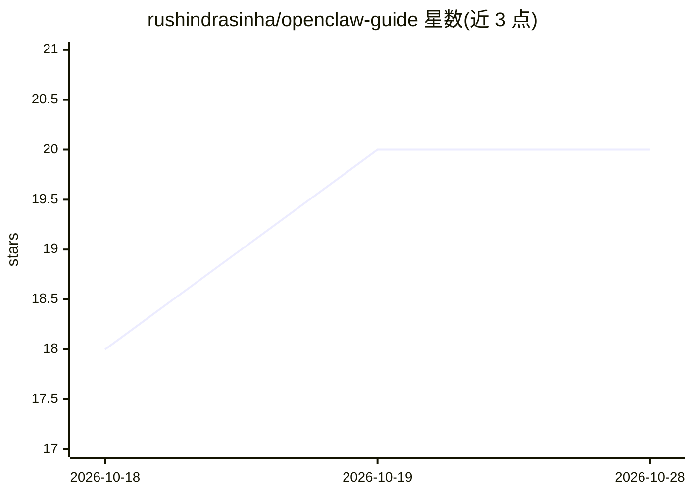

# rushindrasinha/openclaw-guide

⭐ 20 · CSS · 推送 2026-10-14 · [GitHub](https://github.com/rushindrasinha/openclaw-guide) · 个人维护

**OpenClaw 自托管 AI agent 的实践指南与工具链手册**

个人维护的 OpenClaw 使用指南仓库，含三份 PDF 手册（3 页入门、18 页 Bible、6 页 Full Stack），记录作者跨 WhatsApp/Discord 与七台机器日常运行 agent 的配置、命令与经验，覆盖 Soul Stack 文件结构、通道接入、安全权限、自动化与多机 fleet。Quick start 给出 OpenClaw 安装命令与首次配置步骤，仓库另含 ares-skills 等四个相关工具仓库链接与 PDF 构建脚本。

## 筛选速览

| 维度 | 判定 | 备注 |
|---|---|---|
| AI 角色 | `ai-knowledge` | 知识聚合/清单类 |
| 许可风险 | `none` | — |
| 部署形态 | `library` | 以包/库形式分发 |
| 模型依赖 | — | README 未给出锁定关系 |
| 硬件要求 | — | 无带数字的原话,不猜 |
| 安装摩擦 | `low` | 无编译、无系统依赖或容器化 |
| 成熟度 | — | 结构信号不足 |

## 能力要点

- 三份手册覆盖入门、18 页运维手册与 6 页工具链快照
- 记录实际运行数据：94 个自动化、18 个 agent、约 440 个自写脚本
- 提供 Quick start 安装命令与分周信任升级流程
- PDF 由 Markdown 生成，build.sh 一键构建

## 适用场景

- 想搭建自托管 AI agent 的用户按册学习配置与安全实践
- 已用 OpenClaw 的用户参考多机 fleet 与自动化经验
- 构建自己的 agent 技能与工具链

## 场景标签

`教程课程` · 领域:学习与行业

## 证据(README 行号)

> L5:  OpenClaw Guide
> L33: ### 2) The OpenClaw Bible (18 pages)

## 星数曲线

2026-10-18 18 → 2026-10-28 20（+2）

---
*卡片 v1 · prompt 1.4 · 生成 2026-10-28 · 置信度 high · 依据 README sha `fa054171e583` · [字段定义](../../DATASET.md)*
