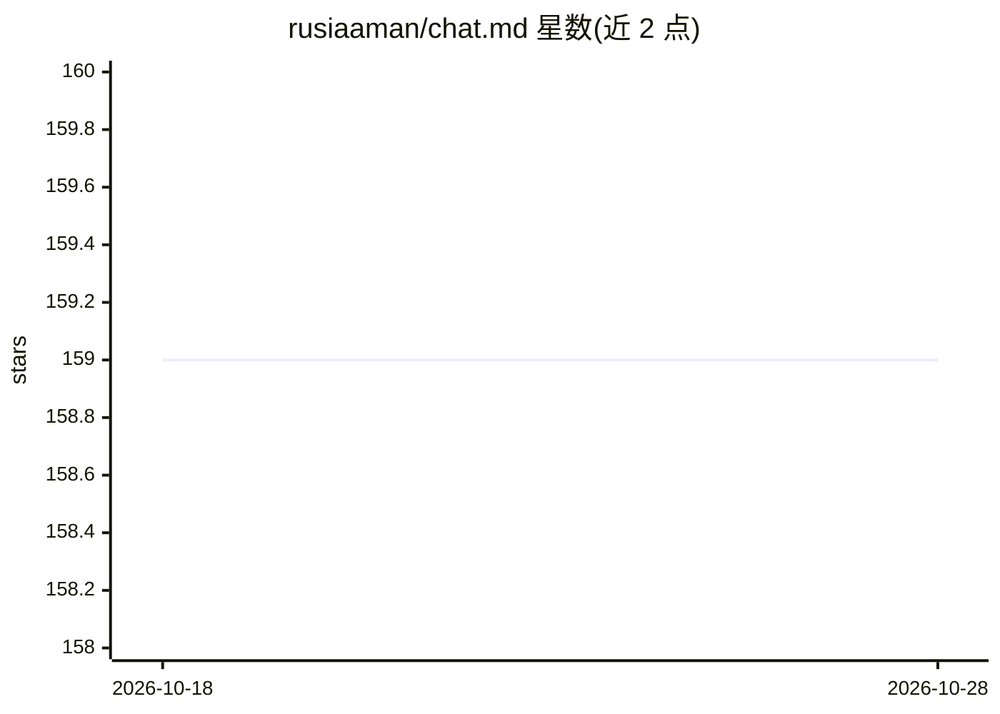

# rusiaaman/chat.md

⭐ 159 · Python · MIT · 推送 2026-09-15 · [GitHub](https://github.com/rusiaaman/chat.md) · 个人维护

**VS Code 扩展：用 markdown 文件作为可编辑的 AI 聊天界面与 MCP 客户端**

chat.md 是一个 Visual Studio Code 扩展，将 AI 对话以 .chat.md 纯文本文件形式承载：对话可任意编辑、分支、续写并用 Git 版本管理，AI 直接把回复写进文件。支持 Anthropic Claude 全系模型、OpenAI（含 Responses API）及任意 OpenAI 兼容端点（Azure、Gemini、ollama 等需经 openai-api 接入）。内置 MCP 客户端，支持 stdio 本地与 Streamable HTTP/SSE 远程 MCP 服务器，任意模型可调用工具。限制：MCP 仅支持 tools，Anthropic API 尚无缓存。作者声明其为 100% AI 编写的 POC，属实验性项目。

## 筛选速览

| 维度 | 判定 | 备注 |
|---|---|---|
| AI 角色 | `ai-native` | 本体是模型或模型工具 |
| 许可风险 | `permissive` | MIT |
| 部署形态 | `None` |  |
| 模型依赖 | local-ok | 支持本地模型 |
| 硬件要求 | — | 无带数字的原话,不猜 |
| 安装摩擦 | `low` | 无编译、无系统依赖或容器化 |
| 成熟度 | `idea` | |

## 能力要点

- 对话即 .chat.md 文件：非线性编辑、改写历史、续写被截断的回复
- MCP 客户端：本地 stdio 与远程 Streamable HTTP/SSE 服务器，工具列表每 5 秒自动刷新
- 多提供商支持：Claude 全系、OpenAI Responses API、任意 OpenAI 兼容端点，会话中可切换模型
- 三级配置系统：文件级 > 提供商级 > 全局

## 适用场景

- 在编辑器内以纯文本文件方式与 AI 对话并用 Git 管理对话历史
- 让任意模型通过 MCP 服务器调用工具执行任务
- 通过编辑 AI 回复来控制对话走向或构造可复用的对话模板

## 场景标签

`聊天机器人` · 领域:对话与助手

## 证据(README 行号)

> L3: **Finally, a fully editable chat interface with MCP support on any LLM.**

## 星数曲线

2026-10-18 159 → 2026-10-28 159（+0）

---
*卡片 v1 · prompt 1.4 · 生成 2026-10-22 · 置信度 high · 依据 README sha `d9c4acf68ea3` · [字段定义](../../DATASET.md)*
