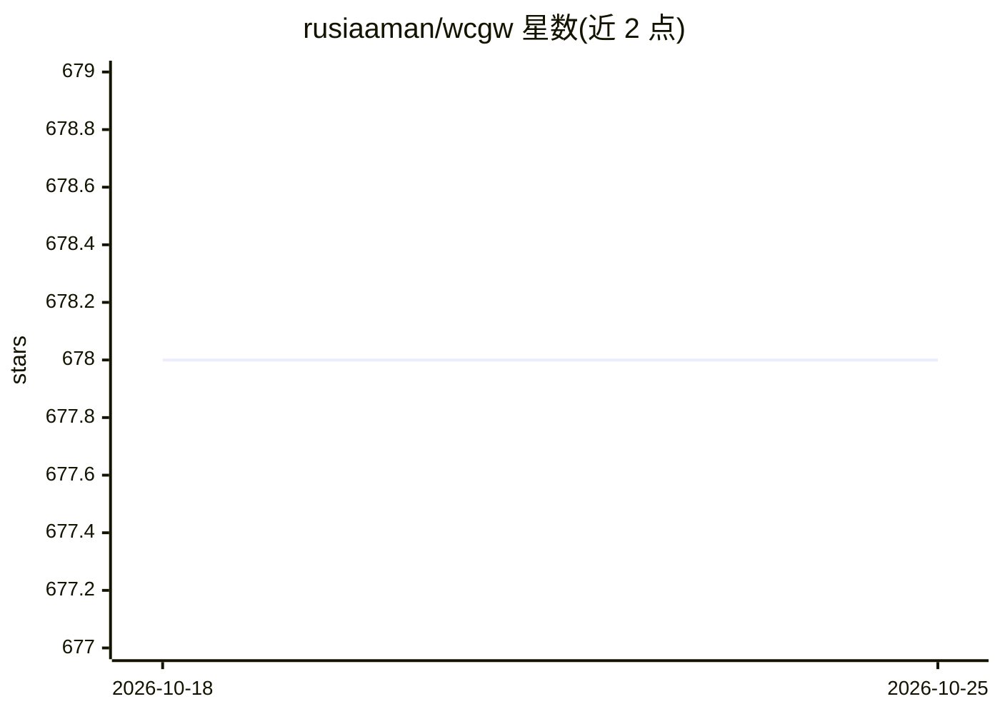

# rusiaaman/wcgw

⭐ 678 · Python · Apache-2.0 · 推送 2026-09-12 · [GitHub](https://github.com/rusiaaman/wcgw) · 个人维护

**面向 Claude 等 MCP 客户端的本地 shell 与代码编辑工具服务器**

wcgw 是一个 MCP server，为聊天应用提供 shell 执行与代码编辑工具，让 agent 在本地机器上运行命令、编辑文件。机制上支持交互式命令（方向键/中断/ANSI 转义）、大文件增量编辑、编辑时语法检查并向 LLM 回报、后台并发命令、任务检查点保存（ContextSave）、自动加载 CLAUDE.md/AGENTS.md，以及 architect/code-writer/wcgw 三种模式。README 明确警告其提供不受限的 shell 与文件访问，存在被误用风险；Windows 仅支持 WSL。通过 uv/uvx 安装运行，另有可选 VS Code 扩展与 Docker 运行配置。

## 筛选速览

| 维度 | 判定 | 备注 |
|---|---|---|
| AI 角色 | `ai-ecosystem` | LLM/agent 周边工具 |
| 许可风险 | `permissive` | Apache-2.0 |
| 部署形态 | `desktop` | 安装包/桌面程序 |
| 模型依赖 | — | README 未给出锁定关系 |
| 硬件要求 | — | 无带数字的原话,不猜 |
| 安装摩擦 | `low` | 无编译、无系统依赖或容器化 |
| 成熟度 | — | 结构信号不足 |

## 能力要点

- 交互式 shell 支持：方向键、中断、ANSI 转义序列与多后台并发命令
- 大文件增量编辑与编辑后语法检查反馈，规避 token 限制
- ContextSave 任务检查点，可在新会话中恢复任务上下文
- 支持 stdio 与 streamable-http 两种 MCP 传输方式

## 适用场景

- 在 Claude 等 MCP 客户端中让 agent 执行本地 shell 命令与编辑代码
- 让 agent 反复运行编译器检查直到错误修复
- 通过 VS Code 扩展附加到 agent 使用的同一终端观察与干预

## 场景标签

`编码 Agent` · 领域:编码与开发

## 证据(README 行号)

> L5: wcgw is an MCP server with tightly integrated shell and code editing tools.
> L9: As of 2026 the reason you could use `wcgw` is that it provides fully interactive shell experience that you and the a

## 星数曲线

2026-10-18 678 → 2026-10-25 678（+0）

---
*卡片 v1 · prompt 1.4 · 生成 2026-10-21 · 置信度 mid · 依据 README sha `8110ef76b20f` · [字段定义](../../DATASET.md)*
