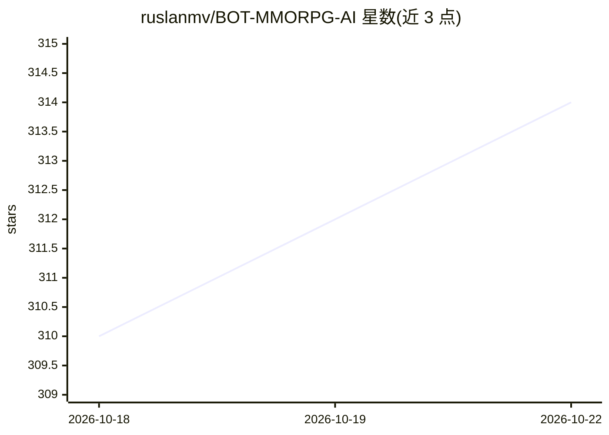

# ruslanmv/BOT-MMORPG-AI

⭐ 314 · Jupyter Notebook · Apache-2.0 · 推送 2026-09-24 · [GitHub](https://github.com/ruslanmv/BOT-MMORPG-AI) · [官网](https://ruslanmv.com/BOT-MMORPG-AI/) · 个人维护

**录制玩家操作并模仿学习的 MMORPG/RPG 自动挂机机器人**

用 PyTorch 实现的游戏自动化机器人：先录制玩家 10-15 分钟的屏幕与键鼠/手柄输入，训练 CNN+LSTM 等视觉模型，之后模型读取屏幕画面自主输出操作，代替玩家完成跑图、刷怪、拾取等重复任务。主推 Genshin Impact，另列 New World、WoW、FFXIV 等 6 个游戏配置。提供 Windows 安装包与源码安装两种途径，含 Eel 图形化启动器（可配 Gemini API key）；支持 4 种动作空间（9-73 动作）与多档输入分辨率，NVIDIA GPU 可加速训练，CPU 亦可运行（2-4 小时）。

## 筛选速览

| 维度 | 判定 | 备注 |
|---|---|---|
| AI 角色 | `ai-native` | 本体是模型或模型工具 |
| 许可风险 | `permissive` | Apache-2.0 |
| 部署形态 | `desktop` | 安装包/桌面程序 |
| 模型依赖 | — | README 未给出锁定关系 |
| 硬件要求 | `cpu-ok` | |
| 安装摩擦 | `high` | 编译与系统依赖俱全 |
| 成熟度 | — | 结构信号不足 |

## 能力要点

- 录制-训练-托管三步流程，从玩家实际操作学习
- 基于计算机视觉的路径识别与导航（EfficientNet-LSTM 等多种架构）
- 键盘+手柄支持，最大 73 动作的 MMORPG 动作空间
- 提供无需命令行的图形化启动器（Eel）

## 适用场景

- 挂机自动刷资源、跑图和战斗，离开时持续运行
- 按自己的玩法路线录制几遍后让 AI 模仿操作
- 在不同 MMORPG 间切换动作空间与分辨率配置

## 场景标签

 · 领域:游戏/自动化机器人

## 证据(README 行号)

> L20: **BOT-MMORPG-AI** is your personal gaming assistant that uses artificial intelligence to play your favorite MMORPG 
> L50: - 🎯 **Learns From You**: Records YOUR gameplay and mimics YOUR style
> L232: This trains the neural network on your gameplay. Time depends on your hardware:

## 星数曲线

2026-10-18 310 → 2026-10-22 314（+4）

---
*卡片 v1 · prompt 1.4 · 生成 2026-10-21 · 置信度 mid · 依据 README sha `a51c20030a75` · [字段定义](../../DATASET.md)*
