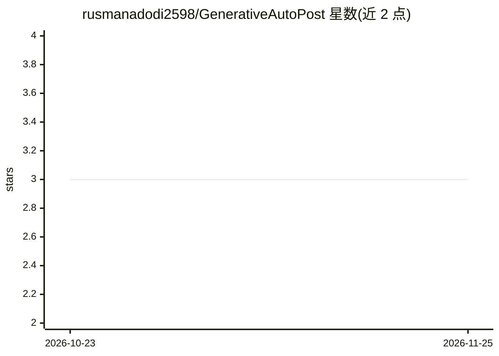

# rusmanadodi2598/GenerativeAutoPost

⭐ 3 · Go · AGPL-3.0 · 推送 2026-10-20 · [GitHub](https://github.com/rusmanadodi2598/GenerativeAutoPost) · [官网](https://app-post.kentangtech.com) · 个人维护

**生成并定时发布社交媒体帖子的 Go+Svelte 平台**

由 Go 后端服务（app-serve，提供 API、处理 webhook 与后台任务）和 Bun+Svelte 管理界面（app-ui）组成的帖子生成与定时发布平台。仓库提供 PostgreSQL 迁移脚本（要求 PostgreSQL 17）、部署配置（docker-compose 与 nginx 边缘配置）、TikTok webhook 回调端点及 Google 登录凭据配置。README 以开发与质量门槛（go vet、staticcheck、gitleaks 等脚本）与本地栈搭建为主，未详述内容生成模型的具体接入方式。

## 筛选速览

| 维度 | 判定 | 备注 |
|---|---|---|
| AI 角色 | `ai-native` | 本体是模型或模型工具 |
| 许可风险 | `viral` | AGPL-3.0 |
| 部署形态 | `None` |  |
| 模型依赖 | — | README 未给出锁定关系 |
| 硬件要求 | — | 无带数字的原话,不猜 |
| 安装摩擦 | `low` | 无编译、无系统依赖或容器化 |
| 成熟度 | — | 结构信号不足 |

## 能力要点

- Go 后端 + Bun/Svelte 管理界面双模块结构
- PostgreSQL 17 迁移脚本（up/down 成对）
- docker-compose 本地栈一键启动与健康检查端点
- gitleaks、go test -race 等脚本化质量门槛

## 适用场景

- 自动生成并按计划发布社交媒体内容
- 接入 TikTok webhook 回调处理发布状态
- 搭建带管理后台的自动化发帖服务

## 场景标签

`AI 写作` `工作流自动化` · 领域:效率与自动化

## 证据(README 行号)

> L3: GenerativeAutoPost is a backend and admin UI for generating and scheduling automated posts. The Go service in `app-s
> L48: GENAUTO_DB_PASSWORD=local-only-secret docker-compose -f deployment/docker-compose.yml up --build

## 星数曲线

2026-10-23 3 → 2026-11-25 3（+0）

---
*卡片 v1 · prompt 1.4 · 生成 2026-11-21 · 置信度 mid · 依据 README sha `b3a3e8c79022` · [字段定义](../../DATASET.md)*
