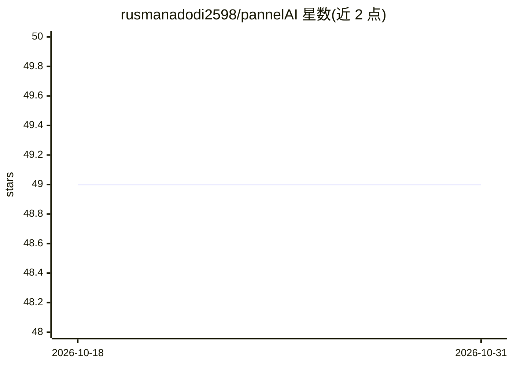

# rusmanadodi2598/pannelAI

⭐ 49 · Go · MIT · 推送 2026-10-24 · [GitHub](https://github.com/rusmanadodi2598/pannelAI) · [官网](https://kentangtech.com) · 个人维护

**Go 编写的自托管 AI API 网关，统一管理客户端访问与多上游转发**

以 Go 单进程实现的 AI 网关，逻辑上分离 Control Plane（会话认证、gateway key、provider/上游端点与 key 管理）与 Data Plane（请求归一化、模型/combo 解析、上游格式转换、retry/timeout）。内置 37 个 provider 的嵌入注册表（源自 9Router 参考），渲染器覆盖 OpenAI、Claude、Gemini；用 PostgreSQL 存配置与用量日志，Redis 存会话、限流与 sticky round-robin。前端为 Svelte 面板，README 自述仍处开发中，部分流程未端到端测试。

## 筛选速览

| 维度 | 判定 | 备注 |
|---|---|---|
| AI 角色 | `ai-ecosystem` | LLM/agent 周边工具 |
| 许可风险 | `permissive` | MIT |
| 部署形态 | `None` |  |
| 模型依赖 | — | README 未给出锁定关系 |
| 硬件要求 | — | 无带数字的原话,不猜 |
| 安装摩擦 | `low` | 无编译、无系统依赖或容器化 |
| 成熟度 | `idea` | |

## 能力要点

- Control Plane 与 Data Plane 逻辑分离的单进程网关
- 嵌入 37 个 provider 注册表，provider 可插件式增改
- OpenAI/Claude/Gemini 上游格式转换，retry 与 per-key circuit breaker
- Svelte 暗色管理面板（Configure/Observe/Optimize/Developer/System 五组界面）

## 适用场景

- 自托管统一接入多个 AI 上游并管理客户端密钥
- 按 combo 策略在多个上游端点间选择与故障转移
- 记录 usage、latency 与请求日志并做配额跟踪

## 场景标签

`模型网关` · 领域:Agent 开发

## 证据(README 行号)

> L11: API Gateway AI berbasis Go untuk mengelola akses klien, provider, upstream endpoint, dan pemilihan model melalui sa
> L17: `app-serv/` sekarang mencakup P0 (config, migrasi, health/version, auth sesi, CRUD gateway keys) dan bagian P1: **r
> L82: |Control Plane|Autentikasi sesi, pengelolaan gateway keys, katalog provider, upstream endpoints dan keys, combos, k

## 星数曲线

2026-10-18 49 → 2026-10-31 49（+0）

---
*卡片 v1 · prompt 1.4 · 生成 2026-10-24 · 置信度 high · 依据 README sha `75ed9e6b9549` · [字段定义](../../DATASET.md)*
